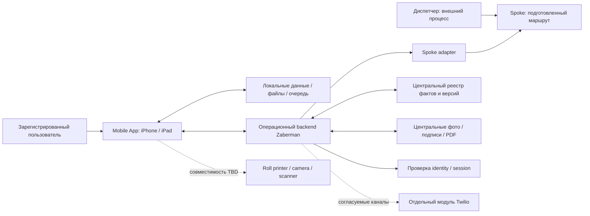
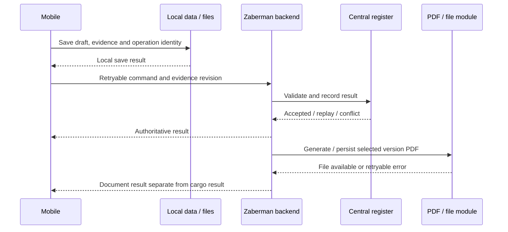

# System Architecture & Integrations — Release 1

> **Уточнение owner о формате работы:** Текущий результат — конкретное пошаговое задание команде разработки. Получение доступов, проверка API/оборудования и технические исследования выполняются командой в ходе реализации и не являются условиями завершения или передачи ТЗ. Вопросы RQ/OQ уточняются по мере возникновения; до ответа используется только явно отмеченная рекомендуемая основа без подмены её утверждённым решением. Если вопрос затрагивает конкретную операцию, команда согласует этот участок с owner, продолжая независимые работы.

**Draft 0.1, 2026-10-16.** Для Product, mobile/backend leads, integration owners и QA. Это рекомендуемая логическая архитектура на согласованной бизнес-основе. Стек, deployment, физическая БД и полные API-контракты ещё не утверждены. Код не меняется.

Источники: [согласованные BD и scope](../requirements/RELEASE_1_DECISIONS.md), [ТЗ](../requirements/TECHNICAL_SPECIFICATION.md), [NFR](../requirements/NON_FUNCTIONAL_REQUIREMENTS.md), [baseline AS-IS](../PROJECT_BASELINE.md), [Stage 0](../references/STAGE_0_PRODUCT_DECISIONS.md), [POC OpenAPI](https://github.com/yarsuleimenov-code/Mobile_app/blob/1abe03ce0cd54697dedf713a0657c5f41f69ece3/backend/openapi.yaml). Старый [architecture reference](https://github.com/yarsuleimenov-code/Mobile_app/blob/main/docs/system-report/ARCHITECTURE.md) не является выбранной production реализацией.

## Рекомендуемое решение

Один операционный backend с логическими модулями и мобильный клиент с устойчивым локальным сохранением. Синхронизация, фото/PDF и адаптер Spoke входят в этот контур; фоновые задания выделены логически, отдельные микросервисы для них не требуются. Это **Proposed architecture**, не новое утверждённое решение и не поручение реализовать её сейчас. Единая граница упрощает подтверждение фактов и эксплуатацию.

Альтернатива — прямое подключение клиента к нескольким внешним системам: потребует отдельных auth/retry/version правил и защиты service credentials. Разделение backend на независимые сервисы рассматривать при доказанной нагрузке или разных владельцах эксплуатации. Browser/localStorage прототип и NestJS POC — evidence, не гарантированно переиспользуемый production foundation.

## Контекст и границы

Adapter читает подготовленный маршрут из Spoke API; обратная запись фактов в Spoke не подтверждена. Центральное хранение в БД/документном контуре обязательно по BD-08/10. Разделение metadata и binary storage логическое: binary в БД или отдельном file store ещё не выбраны. Backend adapter не меняет согласованный источник Spoke.

Вне Mobile App: планирование, назначение и оптимизация маршрутов, решение проблем машины и разрешение проблемной передачи диспетчером. Не включены автоматически: Kommo/Telegram/legacy migrations, desktop dispatch UI, payments, Interstate, общая barcode интеграция и телефония. Наличие прежних схем этих связей не даёт им scope первого релиза.

## Компоненты и ответственность

| Компонент | Ответственность / результат | Связь | Статус |
|---|---|---|---|
| Mobile presentation/domain | Принятые экраны, контекст Order/stop/version, validation BD-09, отдельные handoffs | FR-001–029/033/040/042/048 | Поведение подтверждено; production реализация открыта |
| Local persistence + files | Draft/revision, фото/подписи, cached route и очередь; восстановление записанного после restart | FR-011/046; NFR-001/006/007/008 | Основа принята; engine/cold start/session TBD |
| Sync coordinator | Зависимости, повтор без дублирования, local/pending/confirmed/conflict/error | NFR-002–004/006 | Детализация Proposed |
| Backend command boundary | Identity/revision, бизнес-валидация, устойчивый результат операции | FR-048/050; NFR-003/009/019 | Proposed; DEV context не production identity |
| Operations module | Cargo places, measurements, handoff evidence, Supplemental и факты | FR-011–022/029/030/042/043 | Правила подтверждены; correction зависит от RQ-02 |
| Document module + jobs | Версии/подтверждения, immutable PDF, generation/retry и выдача выбранной версии | FR-016–026; NFR-007/011 | PDF согласован; freeze checkpoint RQ-01 |
| Spoke adapter / route projection | Чтение маршрута, проверка mapping, проекция с source identity | FR-003/004/050 | Источник подтверждён; контракт не получен |
| Identity/session boundary | Проверенная регистрация; все app data/actions для зарегистрированного пользователя | FR-048; NFR-009/010 | Права подтверждены; provider/lifecycle TBD |
| Diagnostics/support | Корреляция, audit actor/version, поддержка retry | NFR-015/016/017 | Proposed; не новый пользовательский admin модуль |

## System of record и данные

| Объект / группа полей | Авторитет / чтение и запись | Ключи и ограничения |
|---|---|---|
| Маршрут, stop sequence/address/time, назначение | Планирование у диспетчера; Mobile получает маршрут из Spoke API | Source namespace + routeId + stopId + Order reference; стабильность проверить |
| Order master, contacts, Requirements, movement_type | Внешний плановый master по PD-014; конкретные field owners не подтверждены | Не объявлять весь Spoke payload master заказа; display number отдельно от immutable key |
| Рабочие имена/заметки, измеренные данные | Операционные изменения Zaberman; внешние исходные поля отдельно | Actor/time/revision; reason BD-09; unknown не 0; signed version не меняется |
| CargoPlace / measurements / handoff facts | Zaberman operational register | UUIDv7 target PD-009, alias отдельно; reprint не создаёт место; n/N — представление |
| Branch / Warehouse | Один бизнес-объект BD-03 | Master справочника и external codes требуют mapping |
| Vehicle / inspection / cycle | Машину назначает ответственное лицо — пользователь; осмотры записывает app | Vehicle/cycle ID, actor/time; source справочника TBD; Issue не снимается reconnect |
| eBOL / POD / PDF / signatures | Zaberman document register | Order/handoff/version, immutable snapshot и confirmations; POD — итоговый вид eBOL |
| Photo / missing-data comment | Evidence конкретной передачи/версии | File identity, автор/время/категория; причина недоступности входит в evidence/PDF |
| Session / пользователь | Identity boundary, provider TBD | Проверенная user identity; DEV_* и client role не доверенный источник |
| Communication delivery | Отдельный модуль после контракта | Provider reference/attempt/receipt; fixture status не delivery receipt |
| Trip / Interstate manifest | Отложенный контур | Не создавать Trip/manifest dependency для Local handoffs |

Это ownership/mapping, не физическая SQL схема. Для каждого интеграционного поля нужны source, право записи, nullable/reason, units, revision и реакция на удаление/отмену. Order-owned movement_type не выводится из Branch; если Spoke его не возвращает, согласовать дополнительный источник, не угадывать значение.

## Сквозной поток данных

1. Пользователь проходит выбранную проверку identity. Новый маршрут загружается после успешного Pre-trip актуального vehicle cycle. Остальные функции не получают нового глобального gate.
2. Adapter получает маршрут Spoke, проверяет ссылки и контекст. Валидная проекция сохраняется; сбой не выдаётся за пустой успешный маршрут. Partial import policy — часть будущего контракта.
3. Pickup/Dropoff открывается с точным Order/stop. Запись draft и файлов даёт локальный результат. Недоступные сведения заменяются указанием отсутствия и причины, а не нулём/фиктивным измерением.
4. Review показывает актуальную evidence revision. Контакт подтверждает signature или реальным verified OTP, водитель подписывает. Все подтверждения относятся к увиденной версии; checkpoint RQ-01 открыт.
5. Команда с устойчивой operation identity отправляется с зависимостями. Сервер проверяет identity/revision/инварианты и возвращает устойчивый результат. До acknowledgement результат local/pending.
6. PDF соответствует неизменяемой версии, включает подписи и причины отсутствующих данных. Ошибка генерации оставляет document pending/error и не откатывает уже принятый грузовой факт.
7. Синхронизированные локальные копии доступны для очистки; последняя unsynced копия сохраняется. Отправка PDF каналом связи — отдельный результат.

Порядок logical commit/result не утверждает физическую transaction схему. Если PDF/asset dependency недоступна, сервер не сообщает о сохранённом документе. Offline PDF generation vs server generation требует проверки renderer/device: local confirmations сами по себе не гарантируют готовый PDF.

## Реестр интеграций

| ID / scope | Направление | Получить / проверить | Ошибки и приёмка |
|---|---|---|---|
| INT-01 Spoke / Core | Spoke API → adapter → route/task cache | Точный продукт/tenant, API owner/docs/version, auth/scopes, sandbox, IDs, timezone/units, paging/rate limits, updates/cancel. Webhook/poll не подтверждены | Timeout, malformed payload, дубль, изменённый stop; повтор не дублирует задачи и не уничтожает draft; активные отмены RQ-03 |
| INT-02 Identity / Core | Provider/session → backend → app | Onboarding/revocation/shared device, offline validity, auth flow/secret storage; provider TBD | Unauthorized online отклонён; pending не исчезают при expiry; logout recovery NFR-010 |
| INT-03 Media/PDF / Core | Capture/signature → local → central; version → PDF | Formats/limits/compression/integrity, resumable retry, template/numbering, access, retention/restore | Partial upload не complete; PDF открывается по правильной версии; нет единственной потерянной unsynced копии |
| INT-04 Camera/scan/print / Conditional | iPhone/iPad camera/decoder; labels → roll printer | OS/models, printer/SDK/connection, Code128/QR compatibility, permissions/fallback | Camera/print failure не создаёт success/новый PlaceID; реальный комплект до hardware acceptance |
| INT-05 Twilio module / Conditional | Backend ↔ отдельный модуль SMS/OTP/email | Owner/readiness, каналы release, sender/recipient verification, challenge/result, callbacks/receipts, retry/retention | Fake OTP не verified; повтор не даёт непредусмотренные дубли; send/delivered раздельны |
| INT-06 Telephony / Deferred | Отдельная команда, BD-13 | Контракт до подключения | Не gate core; визуальный звонок не рабочая связь |
| INT-07 Separate barcode / Deferred | Общий обмен не утверждён, BD-14 | Владельцы фактов и ID mapping до обмена | Не переносить Sheets/stack автоматически; текущий app Scan сохраняется |

Это contract discovery checklist, **не готовые endpoints/payloads**. Официальные API документы Spoke/коммуникационного модуля, tenant и sandbox не предоставлены; HTTP методы, quotas/webhooks не выдуманы. Integration lead уточняет данные/доступ в ходе разработки adapter; это не предварительное условие написания или передачи ТЗ. Отсутствующее поле — gap, не автоматическое расширение app scope.

## Offline и конфликты

BD-07 принимает основу; детализация ниже **Proposed** до технической проверки и закрытия RQ/NFR.

| Случай | Предлагаемое поведение | Ограничение |
|---|---|---|
| Cached route/draft без сети | Читать/записывать доступный контекст; local/pending | Первичный login/import online; offline session TTL открыт |
| Фото/подписи без сети | Сохранить файлы/metadata/очередь; пережить process kill | Durable media/recovery тест; нет обещания background execution SLA |
| Потерян ответ после commit | Повтор той же identity/содержимого или запрос исхода | Один business result; reuse с иным содержимым — conflict |
| Два устройства, unsigned revision | Revision conflict; сохранить несинхронизированную работу для разбора | Универсальный last-write-wins/Keep local не утверждён |
| Подписанная версия | Запрет перезаписи, новая версия/correction | RQ-01/02; полный доступ не снимает invariant |
| Отмена начатой точки | Сохранить факты/evidence, reconciliation с диспетчером | Конечный outcome RQ-03, не фиктивный success |
| Ошибка/отказ передачи | Сообщить диспетчеру, перейти к следующей | BD-05; проблемная не completed |
| Недоступны сведения/фото | Комментарий менеджера что и почему, продолжение | BD-09; не отменяет подписи и save failure |
| Expiry/logout с pending | Не потерять pending; остановить недопустимые online запросы | Полная offline/revocation policy NFR-010 открыта |
| Недостаточно памяти | Только безопасная очистка synced copies | Unsynced не удалять; write failure явно, limits TBD |
| PDF job failure | Retry принятой версии отдельно от cargo state | Unavailable PDF не downloaded/delivered |

## Security и эксплуатация

Рекомендуются verified identity на сервере, защищённые transport/device storage, проверка доступа к файлам, service credentials только на сервере и audit actor/operation/version. Это proposals для технического review; конкретные механизмы/TTL и threat review ещё нужны. Сложный branch RBAC не вводится в Release 1 вопреки BD-06.

Audit различает автора факта и диспетчера, occurrence и server receipt, signed version и correction, retry и второе событие. В технические логи не включаются OTP-коды/секреты/полный приватный payload. Backup/recovery проверяется для metadata и связанных файлов вместе; наличие backup job не доказывает restore. Capacity/latency/RPO/RTO и retention не назначены без workload и решения владельцев.

Нумерация документов, legal wording, удаление и обязательные получатели/каналы требуют владельца документов. Универсальный legal retention срок не предложен; до policy центральное auto-delete не вводится. Внутренние материалы не публикуются в help автоматически.

## Применимость кода и gates

- [Router](https://github.com/yarsuleimenov-code/Mobile_app/blob/1abe03ce0cd54697dedf713a0657c5f41f69ece3/wireframe/src/App.tsx), [Spoke types](https://github.com/yarsuleimenov-code/Mobile_app/blob/1abe03ce0cd54697dedf713a0657c5f41f69ece3/wireframe/src/spokeDomain.ts), [evidence sync](https://github.com/yarsuleimenov-code/Mobile_app/blob/1abe03ce0cd54697dedf713a0657c5f41f69ece3/wireframe/src/useEvidenceSync.ts) — reference. Sync сейчас использует задержку и заданный outcome, не transport.
- [Create CargoPlace service](https://github.com/yarsuleimenov-code/Mobile_app/blob/1abe03ce0cd54697dedf713a0657c5f41f69ece3/backend/src/cargo/create-cargo-place.service.ts) / POC OpenAPI — узкий command slice. До reuse проверить migrations, permissions/idempotency/concurrency/runtime SQL на disposable test DB, заменить DEV identity выбранной production проверкой.
- Принятые target validation/permissions отличаются от локальных gates прототипа; это зарегистрировано, не скрытая реализация.

| Gate | Готово | Остаток / участники |
|---|---|---|
| Начало logical architecture | Scope ядра, Spoke route, полный доступ, PDF/media, offline basis | Разблокировано; draft подготовлен |
| Выбор stack/deployment | iPhone/iPad, один logical operational boundary | IT/mobile/backend: варианты с hardware/media/Spoke проверкой, reuse POC; пока не ADR Approved |
| Signing/correction | Подтверждения и immutable PDF | Owner/Operations: RQ-01/02; template/numbering/verification owner |
| Active assignment / vehicle recovery | Dispatcher outside, gate только import | Operations/Dispatch/fleet: RQ-03/04 |
| Integration implementation | Spoke источник определён | INT-01/02/03 и INT-04/05 по scope: фактические контракты/устройства |
| Pilot / rollout | Можно готовить стенд и QA сценарии | BD-15 workload/принимающий; retention/security/recovery gates; не production ready |

Следующий [Development Plan](../requirements/DEVELOPMENT_PLAN.md) фиксирует зависимости и evidence без неподтверждённых сроков/оценок. Архитектура остаётся draft до технического review.
