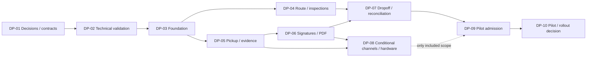

# Development Plan — Release 1

**Draft 0.2, 2026-10-16.** План зависимостей после анализа требований и [архитектурного draft](../architecture/SYSTEM_ARCHITECTURE_AND_INTEGRATIONS.md). Не календарный roadmap, обязательство по срокам/бюджету или разрешение менять код в текущей задаче. Scope — [согласованные BD](RELEASE_1_DECISIONS.md); персональные исполнители/трудоёмкость не назначены.

Рекомендуется вертикальный core flow: маршрут → Pickup → evidence → подписанная версия/PDF → Dropoff/POD → подтверждённая синхронизация. Interstate и отложенные интеграции не становятся зависимостью ядра.

Входит в [пакет ТЗ v1.0](../DEVELOPMENT_HANDOFF.md). Строки этапов фиксируют зависимости и роли; пошаговая таблица ниже — конкретные действия и ожидаемые результаты. Правила FR/AC не дублируются и берутся из ТЗ/RTM.

## Граница текущего задания

Текущий результат — конкретное пошаговое задание команде разработки. Получение доступов, проверка API/оборудования и технические исследования выполняются командой в ходе реализации и не являются условиями завершения или передачи ТЗ. Вопросы RQ/OQ уточняются по мере возникновения; до ответа используется только явно отмеченная рекомендуемая основа без подмены её утверждённым решением. Если вопрос затрагивает конкретную операцию, команда согласует этот участок с owner, продолжая независимые работы.

Дальнейшие критерии проверяет команда при реализации и приёмке продукта. Их невыполнение сейчас не означает незавершённое ТЗ. Наличие credentials/sandbox или ответов на все RQ не требуется для передачи этого пакета.

## Этапы и критерии готовности

| Этап | Работа | Вход / зависимости | Проверяемый результат / gate выхода | Роли |
|---|---|---|---|---|
| DP-01 Разбор задания командой | Принять scope/AC, распределить работы, зарегистрировать RQ/интеграционные уточнения | Переданный пакет ТЗ; доступы пока не обязательны | Команда понимает задачи и результаты; вопросы назначены ответственным и решаются при работе над соответствующим участком | Product/Operations, leads, QA |
| DP-02 Technical validation | Spoke sandbox/поля; iPhone/iPad media/recovery; PDF renderer; printer по scope; reuse POC | DP-01 scope/доступ | Capability test evidence; review/ADR client/backend/storage/deployment; identity boundary | IT, mobile/backend/integration |
| DP-03 Foundation | Environments/CI, identity, central facts/files, local durable data/queue, diagnostics/migrations | DP-02 решения; NFR-009/010/019 | Verified user с полным доступом BD-06; retry/restart proof; server secrets; baseline restore test | Backend/mobile/infrastructure, QA |
| DP-04 Route & inspections | Spoke import, Tasks/stop, vehicle assignment, Pre/Post-trip/gate | DP-03 + INT-01; RQ-04 для Issue recovery | Живой route/cycle, правильный Order/stop; API failure не разрушает draft; нет нового global gate | Mobile/backend/integration, QA |
| DP-05 Pickup & evidence | Draft/groups/PlaceID/measurements/photos, missing reasons, labels/lookup, Supplemental | DP-03; DP-04 для assigned route; INT-03 | Реальные файлы и draft после restart/offline; BD-09; UUID/alias; retry без дублей; print при hardware готовности | Mobile/backend, QA |
| DP-06 Confirmations & PDF | Review/revision, signatures, eBOL/PDF/history/actions; correction граница | DP-05 + RQ-01 + INT-03; RQ-02 до correction | Подписи увиденной версии; immutable PDF; retry без content changes; PDF/cargo results раздельны | Mobile/backend, document owner, QA |
| DP-07 Dropoff & reconciliation | Pickup comparison, Delivery/POD, skip проблемной точки, multi-device/assignment conflicts | DP-06 + RQ-03 | Pickup→Dropoff/POD; unsigned supplements не confirmed; отказ не success; pending/confirmed различаются | Mobile/backend/integration, QA |
| DP-08 Conditional integrations | Реальные SMS/OTP/email; физическая печать | INT-04/05 включены в scope; DP-05/06 | Реальные OTP/receipts/print outcomes; device signature как существующая альтернатива; scope gates явны | Владельцы модулей, mobile, QA |
| DP-09 Pilot admission | UX regression, interrupted operations/devices/security/retention/restore, обучение/поддержка | DP-04–07; DP-08 по scope; BD-15 решён | Evidence FR/NFR/AC; нет блокеров включённого scope; workload/принимающий/rollback/support согласованы | QA, Operations/Product, IT |
| DP-10 Pilot & rollout decision | Наблюдение работы, ошибки, приёмка/готовность расширения | DP-09 admission, доступный пилот | Подтверждённая приёмка/доработки; отдельное решение о расширении | Owner/Operations, QA, IT |

DP-04 и части DP-05/06 допустимо вести параллельно после foundation/contracts. DP-07 требует согласованных версий/состояний. Это зависимости, не трудозатраты или обязательная организация команды.

## QA evidence

| Контур | Проверки / трассировка |
|---|---|
| Route | Import после Pre-trip, свой Order/stop, malformed/duplicate/stale/cancel, RQ-03/04. FR-002–004/009/010/050 |
| Capture | Нет фото/измерений с reason и без, invalid число, known totals, changing Order, файлы после restart. FR-011–014/027/028; NFR-001/007 |
| Confirmations | Contact+driver, revision между сторонами, Supplemental, immutable snapshot/PDF, retry/failure. FR-015–026; NFR-011 |
| Delivery/exceptions | Нет auto completion второй точки, отказ не matches; BD-05 skip отдельно от BD-09 comment. FR-020–023/040–043 |
| Sync/recovery | Airplane mode, process kill, lost ack/replay, два устройства, full storage, expired session с pending. FR-046/048; NFR-001–010 |
| Security/ops | Unauthorized denial, registered full access, file access, no client credentials, metadata+files restore, logs без OTP/secrets. NFR-009–017/019 |
| Hardware/channels | Capture/scan/print/reconnect на выбранном iPhone/iPad/printer; real OTP/receipt. Только по включённому scope. NFR-014; FR-018/026/031/032/044 |

Текущие 155 unit tests — reference regression, не эти production test runs. QA связывает каждый включённый AC с case/environment/version/result. Deferred/Conditional scope не получает PASS без проверки. Неуточнённые детали остаются помеченными в ТЗ; их согласование и проверка производятся командой в ходе разработки, а не требуют предварительного тестирования API автором ТЗ.

## Поздние этапы

- Interstate: сначала lanes/movement, manifest lifecycle, Trip master/checkpoint, discrepancies и receiving→Delivery; затем Loading/Unloading/Interstate BOL. Не prerequisite Local.
- Telephony: отдельная команда BD-13; контракт/приёмка до подключения. SMS/OTP/email требуют своего scope, автоматически не переносятся с calls.
- Barcode: BD-14; до совместного обмена владельцы фактов и совместимость ID. Existing Mobile Scan сохраняется.
- Pilot: BD-15 параметры после доступности пилота, до его приёмки/запуска; стенд не означает production допуск.

## Передача и ближайшая работа

Передать версию ТЗ/RTM, decision snapshot, UI-reference, architecture draft, RQ/INT и test evidence. По OQ-14 обеспечить доступный архив ignored первоисточников либо перечислить недоступные материалы. Старые demo-этапы не production план.

Следующее действие текущей документационной задачи — передать команде пошаговое задание ниже вместе с FR/NFR/AC и прототипом. Получение Spoke API доступа, проверка полей и выбор stack/session/storage входят в работу команды. Owner отвечает на возникающие вопросы по мере поступления; календарь и оценки формирует команда.

## Пошаговое задание команде

Каждая строка — последовательность действий внутри этапа DP. Детальные бизнес-правила и AC берутся из указанных FR/NFR; таблица не вводит новый scope. Для задачи, зависящей от ещё недоступной внешней системы, команда может использовать адаптер и согласованный тестовый набор, но не выдавать его за готовую live интеграцию.

| Шаг | Что сделать по порядку | Что передать / как проверить | Требования |
|---|---|---|---|
| DP-01 | 1. Прочитать scope Release 1 и открыть прототип. 2. Разнести работы mobile/backend/integrations/QA. 3. Внести вопросы RQ/OQ в рабочий журнал с участком реализации и ответственным | Список задач команды со ссылками на FR/AC; спорные пункты явно помечены. Не требовать всех ответов перед началом независимых задач | Release 1 decisions; RTM |
| DP-02 | 1. Выбрать технические средства под iPhone/iPad. 2. Запросить необходимые доступы у владельцев систем. 3. Проверить формат Spoke, files/PDF и выбранное оборудование при работе над этими интеграциями. 4. Зафиксировать ограничения и mapping | Технические решения и описание адаптеров; отсутствующие поля/возможности вынести owner, не подставлять выдуманные данные | FR-050; NFR-007/010/014 |
| DP-03 | 1. Настроить среды и сборку. 2. Реализовать проверку зарегистрированного пользователя с полным доступом. 3. Реализовать центральное и локальное сохранение данных/файлов. 4. Добавить устойчивую очередь и обработку повторов | После перезапуска сохранённые данные доступны; повтор команды не дублирует факт; неподтверждённая запись не показывает success | FR-048; NFR-001/003/006/009 |
| DP-04 | 1. Реализовать назначение автомобиля пользователем и Pre/Post-trip. 2. Ограничить импорт успешным Pre-trip. 3. Загрузить маршрут через Spoke adapter. 4. Показать Tasks и переход к своему Order/stop | Чужой контекст не подставляется; ошибка импорта сохраняет прежние данные; остальные функции не получают глобальный gate. При реализации Issue recovery уточнить RQ-04 | FR-002–004/009/010/050 |
| DP-05 | 1. Реализовать Pickup draft и группы мест. 2. Добавить измерения/расчёты и реальные фото. 3. При недоступных данных требовать комментарий что отсутствует и почему. 4. Сохранить PlaceID/labels/lookup и Supplemental | Ноль фото с объяснением допускает продолжение; без причины — нет. Unknown не 0; autosave/restart и повтор не создают новые места | FR-011–015/027–033; NFR-001/007 |
| DP-06 | 1. Показать review актуальной версии. 2. Реализовать подтверждение контакта и подпись водителя. 3. Сохранить подписи и immutable версию. 4. Создать и сохранить PDF с историей/действиями | PDF относится к выбранной версии; не перезаписывается. При реализации checkpoint/correction уточнить RQ-01/02; ошибка PDF не откатывает принятый факт | FR-016–026/043; NFR-011 |
| DP-07 | 1. Открыть Dropoff своего заказа. 2. Сверить подтверждённый Pickup и supplements. 3. Записать Delivery evidence/причины, собрать подтверждения и POD. 4. Добавить skip проблемной точки и обработку sync conflicts | Отказ не completed; сообщение диспетчеру и переход возможны. Pickup не закрывает Dropoff автоматически. При изменении начатого назначения уточнить RQ-03 | FR-020–023/040–042/046; NFR-002/004 |
| DP-08 | 1. Для включённых каналов подключить отдельный модуль Twilio. 2. Реализовать реальные OTP/email результаты. 3. После выбора принтера подключить печать и fallback | Только проверенный OTP подтверждает контакт; sent отдельно от delivered; reprint не меняет PlaceID. Calls/общая barcode интеграция остаются поздними | FR-018/026/031/032/044; INT-04/05 |
| DP-09 | 1. Связать AC с QA cases. 2. Выполнить сквозную и offline/error regression. 3. Проверить файлы, доступ и восстановление. 4. При подготовке пилота уточнить его параметры с owner | Отчёт по включённым AC, известные дефекты/ограничения, инструкция пользователю и поддержке. Не объявлять deferred/непроверенное PASS | FR/NFR RTM; BD-15 |
| DP-10 | 1. Провести согласованный пилот. 2. Собрать ошибки/обратную связь. 3. Исправить согласованные дефекты. 4. Передать результат owner для приёмки и решения о расширении | Результат приёмки и перечень оставшихся работ; решение о rollout отдельно | NFR-020; BD-15 |
