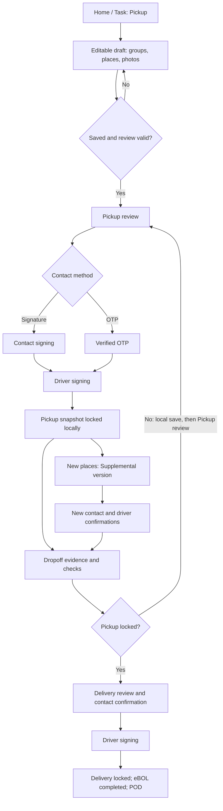
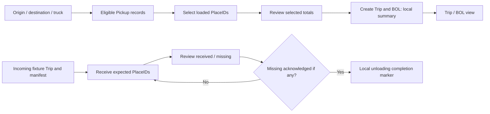
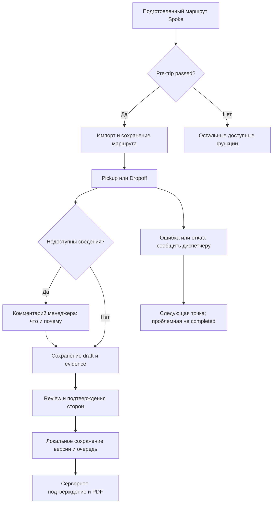

# Workflows и use cases

> **Актуализация 2026-10-16 после согласования.** Сценарии разделяют reference и Release 1 по строкам применимости FR в ТЗ. Нет hard minimum фото; недоступные сведения допускаются с комментарием BD-09. Spoke — маршрут; полный доступ зарегистрированным пользователям; внешняя диспетчеризация; Interstate позднее. Текущие решения: [Release 1 decisions](RELEASE_1_DECISIONS.md).

**Draft 1.0, 2026-10-16.** Переходы описывают утверждённый reference; production переходы, отмеченные Needs Decision, не добавляют функциональность. Источники каждого UC перечислены в связанных [FR](TECHNICAL_SPECIFICATION.md) и [NFR](NON_FUNCTIONAL_REQUIREMENTS.md); номера подтверждённых правил см. [decision log](../decisions/DECISION_LOG.md). Различаются draft, locally saved, locked document snapshot и authoritative server fact.

## Сквозной handoff

Diagram happy path не означает, что Dropoff экран недоступен до Pickup lock: reference допускает local operation save и затем требует Pickup review. Freeze первой подписи vs final driver lock не решён (GAP-08). Server confirmation не показан как существующий backend.

## Interstate: два раздельных reference контура (поздний этап)

Между generated outbound и incoming fixture нет автоматической связи. Persistent confirmed manifest/service, discrepancy lifecycle и последующая Delivery assignment — GAP-14/15/20. Принятый target invariant: Unloading сверяет confirmed loaded manifest; ошибку документа нельзя превращать в rollback accepted cargo fact.

## Release 1: продолжение и синхронизация

RQ-01 определяет freeze checkpoint; диаграмма не утверждает порядок физической генерации PDF относительно local lock. OTP требует реального online verification; device signature остаётся альтернативой. При storage failure переход к подтверждённому сохранению не происходит.

## Каталог сценариев

### UC-01

**Навигация и служебный контекст**

| Поле | Сценарий |
|---|---|
| Статус | Confirmed reference |
| Начальное состояние | Приложение открыто; выбран локальный context; действия в reference не server facts. |
| Последовательность экранов/действий | Home → Tasks/Scan/More → нужный secondary screen; Administration по отдельному входу; Help по RU/EN ссылке. |
| Валидации | Проверить корректный Order/route и prerequisites deep link; unknown route → Home. |
| Системные операции / изменение состояния | Router открывает screen; переход к детали не подтверждает handoff. Reset controls только после подтверждения. |
| Конечное состояние | Открыт выбранный экран, либо понятный blocking/empty state. |
| Альтернативные ветки | Cancel reset сохраняет данные; возврат к draft в том же Order. |
| Ошибки / ограничения | Нельзя использовать role switch как production login. Неизвестный document/context не подменять последним заказом. |
| Требования / источники | [FR-001](TECHNICAL_SPECIFICATION.md#fr-001), [FR-002](TECHNICAL_SPECIFICATION.md#fr-002), [FR-047](TECHNICAL_SPECIFICATION.md#fr-047), [NFR-018](NON_FUNCTIONAL_REQUIREMENTS.md#nfr-018) |

### UC-02

**Pre-trip gate и задачи маршрута**

| Поле | Сценарий |
|---|---|
| Статус | Confirmed Release 1; контракт refresh/cancel открыт |
| Начальное состояние | Home без completed Pre-trip текущего cycle; Tasks может показывать fixture context независимо от Home import. |
| Последовательность экранов/действий | Start Pre-trip → завершить UC-04 → Load today’s route → выбрать stop; в Tasks All/Pickup/Dropoff + поиск → нужная операция. |
| Валидации | Home routeUnlocked требует passed и Post-trip не completed; Task/stop привязаны к своему Order. |
| Системные операции / изменение состояния | Target: импорт подготовленного маршрута через Spoke API после Pre-trip; local cached context сохраняется. AS-IS импорт остаётся fixture. Не объявлять sync date доказательством live receipt. |
| Конечное состояние | Открыт Pickup/Dropoff нужной остановки; простое открытие не завершает работу. |
| Альтернативные ветки | Remove route возвращает Home к import; новый vehicle cycle вновь требует Pre-trip. |
| Ошибки / ограничения | Gate только import по BD-11; остальные функции могут быть открыты. Сбой API не означает успешный пустой импорт; RQ-03/04 остаются. |
| Требования / источники | [FR-003](TECHNICAL_SPECIFICATION.md#fr-003), [FR-004](TECHNICAL_SPECIFICATION.md#fr-004) |

### UC-03

**Заказ, контакты и адрес**

| Поле | Сценарий |
|---|---|
| Статус | Confirmed reference |
| Начальное состояние | Открыта операция/stop конкретного Order. |
| Последовательность экранов/действий | Order details → прочитать Requirements/handling → Team contacts → Copy summary/handle; Navigate/Copy address для своего stop → вернуться. |
| Валидации | Internal name 1..80 перед review; Special Cargo требует details; role edit gates; address/handle validation. |
| Системные операции / изменение состояния | Изменения current details пишут локальную history; существующие locked versions не меняются; Maps — внешний destination link. |
| Конечное состояние | Пользователь получил данные/контакт/адрес; draft сохранён. |
| Альтернативные ветки | При отсутствии адреса/контакта — явная недоступность; Dispatcher edit, Supervisor missing-name fill по reference. |
| Ошибки / ограничения | Не выбирать адрес другой остановки, не выводить автоматическое объединение маршрута из Requirements. |
| Требования / источники | [FR-005](TECHNICAL_SPECIFICATION.md#fr-005), [FR-006](TECHNICAL_SPECIFICATION.md#fr-006), [FR-007](TECHNICAL_SPECIFICATION.md#fr-007), [FR-008](TECHNICAL_SPECIFICATION.md#fr-008) |

### UC-04

**Pre-trip и Post-trip cycle**

| Поле | Сценарий |
|---|---|
| Статус | Confirmed reference |
| Начальное состояние | Pre-trip required/in_progress либо Pre passed и Post-trip ещё не завершён. |
| Последовательность экранов/действий | Pre: 8 checks Pass → пять camera-only ракурсов → attestation → passed. Post: 8 checks + issue descriptions → пять ракурсов → attestation → acknowledgment unfinished stops → complete → next cycle. |
| Валидации | Pre Issue блокирует; Post Issue требует reason, не блокирует report; все photo markers/attestation обязательны. |
| Системные операции / изменение состояния | Сохранить current cycle и историю пар; завершённые записи read-only; next cycle архивирует пару и начинает новый Pre. |
| Конечное состояние | Pre passed открывает Home gate; Post completed не завершает Order/Trip, новый Pre required. |
| Альтернативные ветки | Прервать/возобновить; смотреть previous cycle; Post с описанными Issue завершить. |
| Ошибки / ограничения | Camera/storage недоступны — нет ложного completed; fleet assignment/override/repair и global gate — OQ-12. |
| Требования / источники | [FR-009](TECHNICAL_SPECIFICATION.md#fr-009), [FR-010](TECHNICAL_SPECIFICATION.md#fr-010) |

### UC-05

**Pickup до locked eBOL**

| Поле | Сценарий |
|---|---|
| Статус | Confirmed reference; freeze checkpoint Needs Decision |
| Начальное состояние | Planned/manual Order; original Pickup не locked; editable draft. |
| Последовательность экранов/действий | Home/Task → Pickup → groups/measurements/photos → saved → Continue → draft ready → Open Pickup review → contact signature либо UC-07 OTP → driver signature → lock. |
| Валидации | Достоверный Order/place context, актуальный review; недоступные фото/размеры/вес/иные сведения — комментарий менеджера что отсутствует и почему; contact и driver confirmation остаются обязательны. |
| Системные операции / изменение состояния | Draft→CargoRecord/local eBOL review; до lock evidence обновляется; после final driver lock eBOL pickup_locked и original snapshot immutable. |
| Конечное состояние | Pickup snapshot locked локально; authoritative operation close и sync отдельны. |
| Альтернативные ветки | Нет фото/измерений: сохранённый комментарий BD-09 допускает review; без него блокировка. Ошибка записи — retry, не success. Labels перед review; draft может оставаться незавершённым. |
| Ошибки / ограничения | Save failure/stale review/invalid fields блокируют переход. Stage 0 freeze первой подписи vs driver lock — GAP-08, не закрыт гипотезой. |
| Требования / источники | [FR-011](TECHNICAL_SPECIFICATION.md#fr-011), [FR-012](TECHNICAL_SPECIFICATION.md#fr-012), [FR-013](TECHNICAL_SPECIFICATION.md#fr-013), [FR-014](TECHNICAL_SPECIFICATION.md#fr-014), [FR-016](TECHNICAL_SPECIFICATION.md#fr-016), [FR-017](TECHNICAL_SPECIFICATION.md#fr-017), [NFR-001](NON_FUNCTIONAL_REQUIREMENTS.md#nfr-001) |

### UC-06

**Supplemental после подписи**

| Поле | Сценарий |
|---|---|
| Статус | Confirmed reference |
| Начальное состояние | Original locked; есть новые физические места того же Order. |
| Последовательность экранов/действий | Recent Add places/draft → supplemental draft → новые IDs/фото → create version → review → contact confirmation → driver → locked supplemental. |
| Валидации | Новые места >0; свой evidence и причины unknown; существующий unsigned supplement продолжается. |
| Системные операции / изменение состояния | Добавить новую version/addedPlaceIds и confirmations; сохранить original без изменений; effective Pickup включает только locked supplements. |
| Конечное состояние | Original + locked supplement читаемы; только подтверждённые additions доступны для Delivery. |
| Альтернативные ветки | Unsigned supplement продолжить позже; original всегда read-only. |
| Ошибки / ограничения | Pending additions блокируют Confirm Dropoff; ошибочный исходный факт исправляется через UC-15, не Supplemental. |
| Требования / источники | [FR-015](TECHNICAL_SPECIFICATION.md#fr-015) |

### UC-07

**OTP и комментарии сторон**

| Поле | Сценарий |
|---|---|
| Статус | Confirmed reference; verification contract Needs Decision |
| Начальное состояние | Pickup/Delivery review актуален; выбран contact method и контакт Order. |
| Последовательность экранов/действий | Для signature: comment на шаге контакта → signature → driver comment/signature. Для OTP: reported contact comment → send → шесть цифр → verified → driver comment/signature. |
| Валидации | Контактное подтверждение обязательно, driver всегда; comment change сбрасывает соответствующую confirmation; locked edit запрещён. |
| Системные операции / изменение состояния | Записать method/signer/time/comments в snapshot; OTP хранит masked reference, не код. |
| Конечное состояние | Готовность final driver lock при полном подтверждении; нет самостоятельного server verification в reference. |
| Альтернативные ветки | Device signature — альтернативный способ; invalid/expired/delivery error/offline/locked → допустимый retry по policy. |
| Ошибки / ограничения | Reference matcher/3 attempts/sends не переносить как auth contract. Email copy в reference только signature branch; OQ-08/11. |
| Требования / источники | [FR-018](TECHNICAL_SPECIFICATION.md#fr-018), [FR-019](TECHNICAL_SPECIFICATION.md#fr-019), [NFR-011](NON_FUNCTIONAL_REQUIREMENTS.md#nfr-011) |

### UC-08

**Dropoff → Delivery lock**

| Поле | Сценарий |
|---|---|
| Статус | Confirmed reference; authoritative checkpoint Needs Decision |
| Начальное состояние | Order CargoRecord найден; Delivery ещё не locked. |
| Последовательность экранов/действий | Home/Task → Dropoff → Search/сверка Pickup → Delivery photos/condition → matches → Confirm Dropoff; если Pickup locked → Delivery review → contact signature/OTP → driver → completed eBOL. |
| Валидации | Недоступные сведения/фото допускаются с комментарием BD-09; физическое несовпадение/отказ не маскировать matches. Нужны свой Order, актуальная версия и подтверждения; unsigned additions отдельно. |
| Системные операции / изменение состояния | Сохранить Delivery draft. При Pickup locked сначала сохранить Delivery review, затем локальный dropoff_complete; lock Delivery завершает eBOL. |
| Конечное состояние | При обеих locked snapshots eBOL completed и POD доступен; local record completion отдельно. |
| Альтернативные ветки | Нет фото: сохранить причину и продолжить. Ошибка/отказ передачи: сообщить диспетчеру и открыть другую точку, не завершив проблемную (BD-05). Pickup не locked: сохранить draft и перейти к Pickup review. |
| Ошибки / ограничения | Unknown Order, changed query, pending additions/storage/document failure не дают обычный success. Refused/partial не маскировать matches=true. |
| Требования / источники | [FR-020](TECHNICAL_SPECIFICATION.md#fr-020), [FR-021](TECHNICAL_SPECIFICATION.md#fr-021), [FR-022](TECHNICAL_SPECIFICATION.md#fr-022) |

### UC-09

**POD, версии, действия и копия**

| Поле | Сценарий |
|---|---|
| Статус | Confirmed reference; реальные каналы Needs Decision |
| Начальное состояние | Для POD eBOL completed и обе записи locked; для версии есть locked snapshot. |
| Последовательность экранов/действий | Home docs → актуальный eBOL/POD → Document versions → конкретный original/Supplemental/Delivery → action dialog → параметры → результат. |
| Валидации | POD guard, documentKey, permissions target; email copy в contact signature step с валидным адресом до driver lock. |
| Системные операции / изменение состояния | Показать frozen evidence соответствующей версии; запрос копии привязан к версии. Reference actions/queue — локальные результаты. |
| Конечное состояние | Подписанный PDF выбранной версии доступен и сохраняется централизованно по BD-08/10; результаты generation/send/delivery раздельны. AS-IS PDF/отправка остаются имитацией. |
| Альтернативные ветки | Cancel action; retry error; offline copy pending; contact Change сбрасывает подписи. |
| Ошибки / ограничения | Недоступный POD/key — block/empty; invalid email блокирует выбранный copy step; production channels/numbers/retention OQ-08/11. |
| Требования / источники | [FR-023](TECHNICAL_SPECIFICATION.md#fr-023), [FR-024](TECHNICAL_SPECIFICATION.md#fr-024), [FR-025](TECHNICAL_SPECIFICATION.md#fr-025), [FR-026](TECHNICAL_SPECIFICATION.md#fr-026) |

### UC-10

**Cargo photos**

| Поле | Сценарий |
|---|---|
| Статус | Confirmed reference; real files Proposed |
| Начальное состояние | Editable draft либо read-only подписанный evidence. |
| Последовательность экранов/действий | В draft выбрать category → camera/gallery → preview/filter → удалить выбранное фото → autosave; открыть locked version для чтения. |
| Валидации | ID/handoff/Order context; cargo minimum перед review; inspection camera-only отдельно. |
| Системные операции / изменение состояния | Сохранить metadata/фото связи в draft/queue; frozen набор версии не заменять текущей коллекцией. |
| Конечное состояние | Фото относится к нужной передаче и версии; новая revision остаётся pending до своей синхронизации. |
| Альтернативные ветки | Unavailable camera — cargo gallery где доступна; category filter не удаляет данные. |
| Ошибки / ограничения | Нет места/ошибка file storage — production gap; mock asset не evidence оригинального файла, лимиты/quality OQ-05. |
| Требования / источники | [FR-027](TECHNICAL_SPECIFICATION.md#fr-027), [FR-028](TECHNICAL_SPECIFICATION.md#fr-028), [NFR-007](NON_FUNCTIONAL_REQUIREMENTS.md#nfr-007) |

### UC-11

**Cargo, labels и общий Scan**

| Поле | Сценарий |
|---|---|
| Статус | Confirmed reference; hardware policy Needs Decision |
| Начальное состояние | Cargo catalogue/Order places доступны, known version для labels. |
| Последовательность экранов/действий | More Cargo places → карточка PlaceID; labels → version filter → all/selected/one → preview → Print/reprint; Scan → lookup/manual → open place/order. |
| Валидации | Barcode/PlaceID parse, selected version, known vs duplicate vs unknown; общий Scan не mutation. |
| Системные операции / изменение состояния | Показать projections/history; print attempt отдельно от generation; reprint сохраняет identity/active code. |
| Конечное состояние | Найденное место/версия или print result; груз не перемещён общим lookup. |
| Альтернативные ветки | Printer unavailable: сохранить/продолжить draft/review, ручной ID; unknown scan не создаёт место. |
| Ошибки / ограничения | Real QR/SDK/printer compatibility и replacement — OQ-09; prototype ZB alias не primary UUID policy. |
| Требования / источники | [FR-029](TECHNICAL_SPECIFICATION.md#fr-029), [FR-030](TECHNICAL_SPECIFICATION.md#fr-030), [FR-031](TECHNICAL_SPECIFICATION.md#fr-031), [FR-032](TECHNICAL_SPECIFICATION.md#fr-032), [FR-033](TECHNICAL_SPECIFICATION.md#fr-033), [NFR-014](NON_FUNCTIONAL_REQUIREMENTS.md#nfr-014) |

### UC-12

**Interstate outbound Loading**

| Поле | Сценарий |
|---|---|
| Статус | Confirmed reference; persistent manifest/assignment Needs Decision |
| Начальное состояние | Есть pickup_recorded records по выбранным origin/destination; selection пуст или текущий. |
| Последовательность экранов/действий | More Interstate → origin≠destination/truck → Start loading → scan/select/load remaining → Review loaded → Create Trip & BOL → Trip → Open BOL. |
| Валидации | Eligibility reference = status+branches; ≥1 selected; membership и duplicate; totals только selected places. |
| Системные операции / изменение состояния | Reference selection и generatedTrip в памяти, Trip содержит totals/sample IDs/date. Target confirmed membership/version/final Close — gap, не существующий service. |
| Конечное состояние | Показан Trip summary/BOL local result; source cargo record не переходит в Delivery автоматически. |
| Альтернативные ветки | Partial selection; change direction очищает selection; View trip details возвращает review. |
| Ошибки / ограничения | Empty review → Loading; unknown scan не меняет counts; crash/reload recovery outbound не реализована. Нумерация/manifest authority — OQ-03/07/08. |
| Требования / источники | [FR-034](TECHNICAL_SPECIFICATION.md#fr-034), [FR-035](TECHNICAL_SPECIFICATION.md#fr-035), [FR-036](TECHNICAL_SPECIFICATION.md#fr-036) |

### UC-13

**Incoming Unloading и BOL archive**

| Поле | Сценарий |
|---|---|
| Статус | Confirmed reference; discrepancy service Needs Decision |
| Начальное состояние | Доступен incoming fixture Trip с fixed manifest либо BOL archive record. |
| Последовательность экранов/действий | Incoming Trip → receive scan/select/remaining → review expected/received/missing → acknowledgment missing → Confirm unloading; archive → search/filter → BOL. |
| Валидации | Membership по manifest; duplicate не увеличивает; missing acknowledgment обязателен, когда missing>0. |
| Системные операции / изменение состояния | Persist received IDs per Trip и completed marker. Reference discrepancy message не создаёт authoritative case records. |
| Конечное состояние | Read-only receiving result/unloaded marker; BOL показывается в контексте Trip. |
| Альтернативные ветки | Continue receiving; restore receiving draft; архив in_transit/closed. |
| Ошибки / ограничения | Не связывать outbound автоматически с incoming fixture. Полный discrepancy lifecycle, final server close и next Delivery task — OQ-03/04/07. |
| Требования / источники | [FR-037](TECHNICAL_SPECIFICATION.md#fr-037), [FR-038](TECHNICAL_SPECIFICATION.md#fr-038), [FR-039](TECHNICAL_SPECIFICATION.md#fr-039), [NFR-005](NON_FUNCTIONAL_REQUIREMENTS.md#nfr-005) |

### UC-14

**Local и Same Day**

| Поле | Сценарий |
|---|---|
| Статус | Confirmed core boundary; Interstate позднее |
| Начальное состояние | Диспетчер создал/назначил отдельные точки вне Mobile App; маршрут получен из Spoke. |
| Последовательность экранов/действий | Local/Same Day исполняют UC-05 и UC-08 как отдельные назначенные handoffs. Приложение не создаёт автоматическую пару и не выполняет dispatch orchestration. |
| Валидации | movement_type владелец Order; равенство Branch не определяет Same Day. |
| Системные операции / изменение состояния | Нет обязательного Interstate Trip/manifest/BOL для local; следующая назначенная точка открывается пользователем из Tasks; автоматическая orchestration вне приложения. |
| Конечное состояние | Сохранён результат отдельной передачи; общий Same Day completed не заявлен. |
| Альтернативные ветки | Отсутствующую точку уточнить с диспетчером; если есть ошибка — BD-05, без автоматического completed. |
| Ошибки / ограничения | Отсутствующую точку уточнить у диспетчера; изменения начатого назначения — RQ-03; отдельный SameDayScreen не требуется. |
| Требования / источники | [FR-040](TECHNICAL_SPECIFICATION.md#fr-040), [FR-041](TECHNICAL_SPECIFICATION.md#fr-041), [FR-049](TECHNICAL_SPECIFICATION.md#fr-049) |

### UC-15

**Расхождения и correction**

| Поле | Сценарий |
|---|---|
| Статус | Confirmed базовая эскалация; correction/void RQ-02 |
| Начальное состояние | Есть повреждение/несовпадение либо ошибочный подтверждённый факт. |
| Последовательность экранов/действий | Damage с reason → review/confirm; недоступные данные → комментарий BD-09; ошибка/отказ → сообщение диспетчеру и переход к следующей точке без completion. Исправление подписанного факта отдельно по RQ-02. |
| Валидации | Нельзя переписать signed snapshot; новые физические места — Supplemental; refused/partial нельзя сделать full success. |
| Системные операции / изменение состояния | Target correction/reversal сохраняет reason/actor/time/reference; full UI и permissions пока отсутствуют. |
| Конечное состояние | Исходный confirmed факт сохранён; новое outcome/correction traceable после согласования процесса. |
| Альтернативные ветки | Внешняя эскалация утверждена BD-05; комментарий об отсутствии данных не является correction подписанной версии. |
| Ошибки / ограничения | Неопределённый correction/void outcome уточнить по RQ-02 при реализации; полный доступ BD-06 сохраняется, signed snapshot не перезаписывается. |
| Требования / источники | [FR-042](TECHNICAL_SPECIFICATION.md#fr-042), [FR-043](TECHNICAL_SPECIFICATION.md#fr-043), [NFR-015](NON_FUNCTIONAL_REQUIREMENTS.md#nfr-015) |

### UC-16

**Сообщения и визуальный call**

| Поле | Сценарий |
|---|---|
| Статус | Confirmed reference; real providers Needs Decision |
| Начальное состояние | Есть Order thread/contact; доступ из Home/Tasks/Details/Pickup. |
| Последовательность экранов/действий | Inbox search/All-Unread → thread → quick/custom message → status/retry; call → Start→connected→Mute/Speaker→End→return. |
| Валидации | Контекст Order и corporate sender; сообщение не попадает в другой thread. |
| Системные операции / изменение состояния | Reference message queue/unread/local incoming и call state; аудио/real SMS/телефония отсутствуют. |
| Конечное состояние | Локальное сообщение/статус или завершённый visual call в том же контексте. |
| Альтернативные ветки | Offline pending, failed retry; повтор call; нет сообщений — empty thread. |
| Ошибки / ограничения | Не выдавать local sent/connected за provider outcome; incoming webhooks/push/receipts, sender policy — OQ-11. |
| Требования / источники | [FR-044](TECHNICAL_SPECIFICATION.md#fr-044), [FR-045](TECHNICAL_SPECIFICATION.md#fr-045) |

### UC-17

**Offline, sync и восстановление**

| Поле | Сценарий |
|---|---|
| Статус | Confirmed UI; production protocol Needs Decision |
| Начальное состояние | Cached context и сохранённый draft; может быть pending/retry/conflict/rejected. |
| Последовательность экранов/действий | Изменить draft/photo → saved/pending → offline/restart в supported reference scope → reconnect → Sync now → success/retry/conflict → допустимое действие. |
| Валидации | Revision-aware acknowledgment; нельзя подтвердить более свежий edit поздним результатом; Close server rule отдельно. |
| Системные операции / изменение состояния | Reference queue хранит metadata, retry/revisions; Keep local requeues local selection. Production dependency order/merge/TTL не выбран. |
| Конечное состояние | Reference entries synced либо pending/review; target confirmed только после trusted server acknowledgement. |
| Альтернативные ветки | Режим slow/error, low storage, crash, unknown result → policy NFR-001–006. |
| Ошибки / ограничения | Multi-device/assignment/signed conflict, cold start, outgoing Loading recovery — OQ-07; не применять unconditional keep-local. |
| Требования / источники | [FR-046](TECHNICAL_SPECIFICATION.md#fr-046), [NFR-002](NON_FUNCTIONAL_REQUIREMENTS.md#nfr-002), [NFR-003](NON_FUNCTIONAL_REQUIREMENTS.md#nfr-003), [NFR-004](NON_FUNCTIONAL_REQUIREMENTS.md#nfr-004), [NFR-006](NON_FUNCTIONAL_REQUIREMENTS.md#nfr-006), [NFR-016](NON_FUNCTIONAL_REQUIREMENTS.md#nfr-016) |

### UC-18

**Production access и boundary validation**

| Поле | Сценарий |
|---|---|
| Статус | Needs Decision / Proposed NFR; Confirmed target invariants |
| Начальное состояние | Release 1: полный доступ зарегистрированному пользователю, Spoke route и центральные PDF определены; session/API/hardware/численные NFR ещё уточняются. |
| Последовательность экранов/действий | После решения: verified user→context/scope→read tasks→authorized operation→trusted service outcome; проверить provider/DB/device failures и transfer evidence. |
| Валидации | Проверенная личность пользователя, stable ID/idempotency, immutable facts; branch/assignment deny не требуется BD-06. Численные NFR только после согласования. |
| Системные операции / изменение состояния | Компонентам назначаются ownership и результат; интерфейсы/БД физически здесь не проектируются. |
| Конечное состояние | После согласования доказуемый outcome и audit; до него только draft/test plan, не реализация. |
| Альтернативные ветки | Denied/revoked/offline session и degraded dependencies по approved matrix. |
| Ошибки / ограничения | POC DEV context/health не whole-system API; live providers и runtime PostgreSQL gate остаются за пределами проведённого анализа. |
| Требования / источники | [FR-048](TECHNICAL_SPECIFICATION.md#fr-048), [FR-050](TECHNICAL_SPECIFICATION.md#fr-050), [NFR-008](NON_FUNCTIONAL_REQUIREMENTS.md#nfr-008), [NFR-009](NON_FUNCTIONAL_REQUIREMENTS.md#nfr-009), [NFR-010](NON_FUNCTIONAL_REQUIREMENTS.md#nfr-010), [NFR-012](NON_FUNCTIONAL_REQUIREMENTS.md#nfr-012), [NFR-013](NON_FUNCTIONAL_REQUIREMENTS.md#nfr-013), [NFR-017](NON_FUNCTIONAL_REQUIREMENTS.md#nfr-017), [NFR-019](NON_FUNCTIONAL_REQUIREMENTS.md#nfr-019), [NFR-020](NON_FUNCTIONAL_REQUIREMENTS.md#nfr-020) |

## Модель состояний: границы интерпретации

| Объект | Подтверждённые reference переходы | Что не считать утверждённым/реализованным |
|---|---|---|
| Pickup draft | Editable → saved → ready/review; original при lock read-only | Saved не authoritative closed; нет complete server operation service |
| eBOL | pickup_review → pickup_locked; delivery_review → completed после driver lock | Declared draft/in_transit/correction_requested не доказывают доступные полные flows |
| Supplemental | draft → locked с новой version; original immutable | Unsigned additions не Delivery composition; correction не новое физическое место |
| Delivery record vs document | Local Confirm Dropoff может дать dropoff_complete; document completion отдельно | До Pickup lock не разрешён Delivery signing; local status не финальная server выдача |
| Inspection cycle | required/in_progress/blocked → passed; Post report → cycle completed → new Pre required | Issue не снимается reconnect; cycle не shift accounting и не auto completion заказов |
| Interstate | Selected subset → review → generated summary; receiving draft → local completion marker | Persistent outbound manifest, globally unique numbers, atomic server close и real discrepancy case не реализованы |
| Sync | pending/retry/conflict/rejected → local result с revision guard | Не выбраны production merge, ordering и authoritative ack protocol |

Полная state-transition policy для partial/refused, отмены задач, corrections/void, concurrent assignments и document legal/delivery status — условия окончательного согласования, а не восстановленные по названию enum решения.

