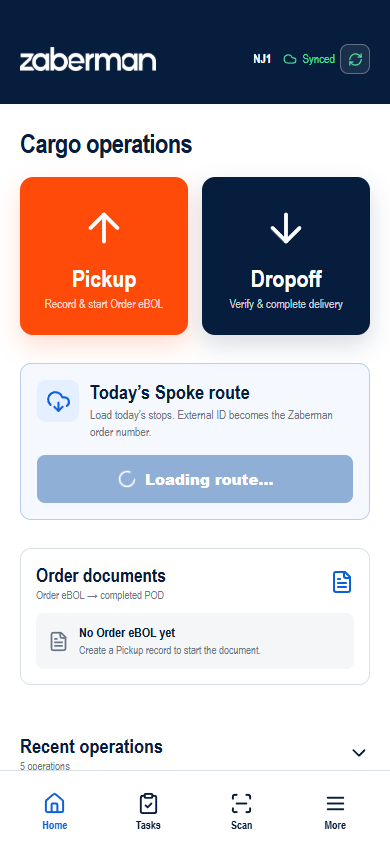
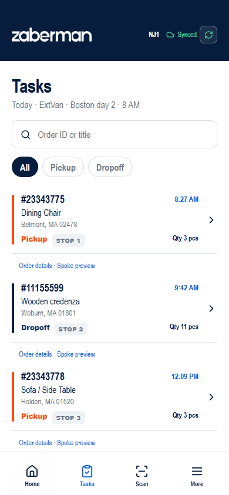
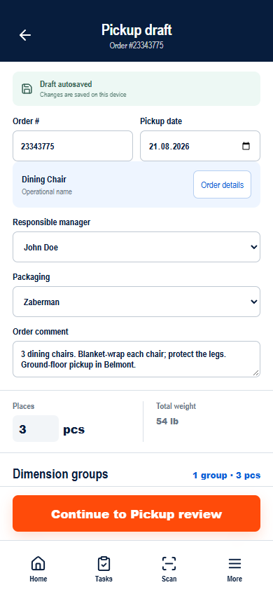
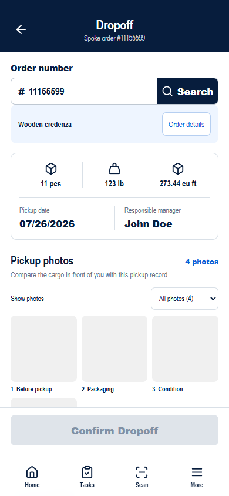
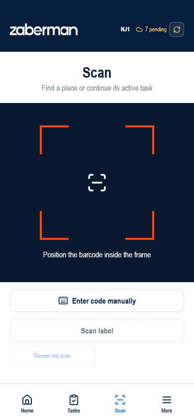
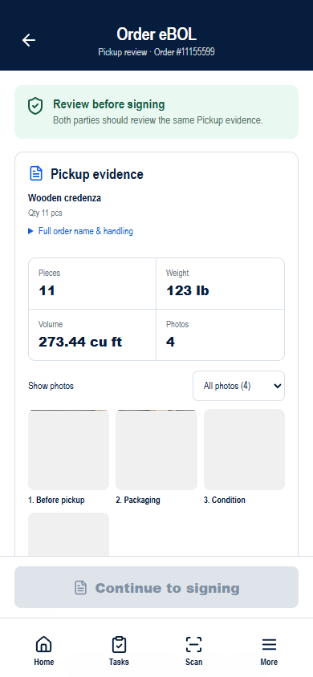
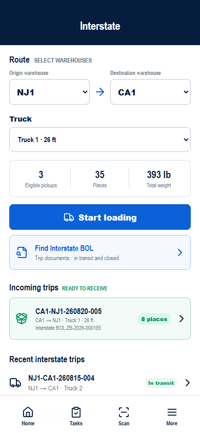

# Руководство пользователя

В **Place labels** при открытии предпросмотра создаётся набор этикеток и фиксируется местоположение. Для сверки кода и адреса текущей точки нажмите **Check label / enter PlaceID** на этикетках или **Check label** в Delivery. Последний результат сохраняется на устройстве. eBOL можно подписать и без проверки, и при предупреждении. История проверок ранее подписанных версий доступна в **Document versions**.

Руководство описывает **активный** интерфейс Mobile App. Кнопки меняют локальные данные прототипа; загрузка маршрута, работа устройств, подписи, отправка документов и синхронизация являются симуляциями. При выполнении операции сверяйте номер заказа и PlaceID на экране. Для первого знакомства начните с [краткого руководства](quick-start.md).

## Начало работы и навигация

*На Home выберите операцию или откройте остановку загруженного маршрута.*

Первый экран — **Cargo operations**. Компактная строка **Manual operations** содержит **Pickup** и **Delivery** для прямого открытия операции, в том числе без загруженного маршрута. Для дополнительных мест к подписанному Pickup используйте **Recent operations → Add places** или продолжите **Supplemental Pickup** из **Pickup drafts**; исходная подписанная версия остаётся заблокированной. Карточка **Pre-trip inspection** управляет доступом к **Load today’s route**: маршрут заблокирован до успешного осмотра. Загруженный маршрут показывает локальные остановки Spoke с номером заказа, порядком, временем, типом операции, количеством и адресом. В списке можно искать по External ID. При наличии локальных данных ниже появляются Order documents, черновики Pickup и Recent operations.

Нижнее меню:

| Раздел | Для чего нужен |
| --- | --- |
| **Home** | Открыть Pickup/Delivery, загрузить остановки, продолжить черновик или открыть Order eBOL. |
| **Tasks** | Найти остановку по номеру/названию заказа, выбрать All/Pickup/Delivery, открыть операцию или Order details. |
| **Scan** | Найти PlaceID или Order ID и открыть запись груза. Этот раздел не фиксирует загрузку или доставку. |
| **More** | Help & Instructions, Sync now, Cargo places, Interstate operations и Administration. В Administration управляются роль, филиал, сеть, результаты операций, доступность устройств и локальные сценарные данные для показа. |

### Карта активных экранов

Маршруты ниже используются после символа `#` в адресе развёрнутого сайта. Экраны интерактивны в прототипе, но внешние действия и backend имитируются.

| Откуда | Экран и маршрут | Следующий шаг |
| --- | --- | --- |
| Открытие приложения | Cargo operations — `#/` | Pickup, Delivery, загрузка маршрута, Order documents |
| Home | Pre-trip inspection — `#/pre-trip-inspection` | Одометр, 13 фото и подтверждение водителя |
| Home после Pre-trip | Post-trip inspection — `#/post-trip-inspection` | Состояние автомобиля после использования; просмотр результата и истории |
| Home / нижнее меню | Tasks — `#/tasks` | Операция остановки или Order details |
| Нижнее меню | Scan — #/scan | Запись места или места заказа |
| Home / Inbox / Tasks / Pickup draft / Order details | Messages & Calls — #/communications, #/communications?tab=calls, #/orders/{number}/communications | Сообщения, история звонков и связь с клиентом выбранного заказа |
| Нижнее меню | More — `#/more` | Help & Instructions, Interstate, Cargo places, Sync now, Administration |
| Home / Tasks | Pickup draft — `#/pickup?order={number}` | Pickup review или Place labels |
| Tasks / Pickup | Order details — `#/orders/{number}/details` | Возврат к операции |
| Pickup | Place labels — `#/orders/{number}/labels` | Preview/Print, Scan, Pickup review |
| Pickup | Pickup review — `#/orders/{number}/ebol/pickup` | Pickup signing |
| Pickup review | Pickup signing — `#/orders/{number}/ebol/pickup/sign` | Заблокированная запись Pickup |
| Home / Tasks | Delivery — `#/dropoff?order={number}` | Delivery review или Pickup review |
| Delivery | Delivery review — `#/orders/{number}/ebol/delivery` | Delivery signing |
| Delivery review | Delivery signing — `#/orders/{number}/ebol/delivery/sign` | Завершённый Order eBOL / POD |
| Завершённый Order eBOL | POD — `#/orders/{number}/ebol/pod` | Версии документа и действия |
| More | Help & Instructions — `/Mobile_app/help/ru/` | Открыть адаптированную для телефона инструкцию; язык меняется в меню документации |
| More | Cargo places — `#/places`; место — `#/places/{PlaceID}` | Статус, местоположение, история |
| More | Interstate — `#/interstate` | Загрузка, входящий рейс, архив BOL |
| Interstate | Loading — `#/interstate/loading` | Review — `#/interstate/review`; Trip — `#/interstate/trip` |
| Interstate | Unloading — `#/interstate/unloading/{TripID}` | Проверка и подтверждение разгрузки |
| Interstate | Архив BOL — `#/interstate/bols`; документ — `#/interstate/bol/{BOL number}` | Просмотр, Save as PDF, Print |

В коде есть старые компоненты Home, Pickup, Delivery и Same Day, не подключённые к активному роутеру. Они не являются пользовательскими инструкциями. [Источник маршрутов](../../../wireframe/src/App.tsx).

## Предрейсовый осмотр

1. На Home откройте **Pre-trip inspection** через **Start** или **Continue**.
2. На экране **Vehicle** зафиксируйте четыре стороны машины и приборную панель. Введите показание одометра в целых милях и нажмите **Continue to equipment**.
3. Сделайте восемь фото на экране **Equipment** и нажмите **Review inspection**. Проверьте список 13 фото, одометр и имя ответственного.
4. Установите **I confirm this vehicle is safe to operate** и нажмите **Complete inspection**. На Home станет доступно **Load today’s route**.

## Послерейсовый осмотр

1. После Pre-trip откройте **Post-trip inspection** на Home. Если был маршрут, сначала зафиксируйте возврат на склад через **Complete route**.
2. Зафиксируйте те же 13 фото на экранах **Vehicle** и **Equipment** и введите конечное показание одометра. Если начальное показание есть, конечное должно быть не меньше. Разница отображается как **Trip distance**.
3. Подтвердите запись и нажмите **Complete Post-trip**.
4. **Start next vehicle cycle** переносит пару осмотров в **Previous vehicle inspections**. Завершённые записи доступны для просмотра. В старых записях показания и имя могут отсутствовать.

Черновики и отметки о фото сохраняются в браузере. Если показано **Camera unavailable**, восстановите доступ к камере для недостающих фото.

## Завершение маршрута на складе

На Home появится **Return to warehouse**, когда все остановки завершены или отмечены **Failed** с причиной. По прибытии на склад нажмите **Complete route**. Сохранённое время возврата разделяет маршрутное и складское время. Откройте **Post-trip inspection** отдельно, когда будете готовы к осмотру. В истории видны время последней точки, возврата и осмотра.

## Загрузка завтрашнего рейса

Откройте **Route Loading** на Home, чтобы посмотреть завтрашний маршрут склада со всеми Pickup и Delivery. Нажмите **Start loading**, чтобы увидеть только Delivery, назначенные для загрузки на складе. В обоих режимах **Broker photos** открывает справочные фото брокера, а **Packing photos** показывает упакованный груз.

Сканируйте каждое место при погрузке в машину либо введите его **PlaceID** и нажмите **Add**. Приложение сверяет код со списком мест рейса. Если место вынесли из машины до завершения загрузки, нажмите **Remove** рядом с ним. Прогресс сохраняется на устройстве, поэтому загрузку можно продолжить после выхода или обновления страницы.

Когда все места загружены, нажмите **Complete loading**. В завершённой записи доступны список подтверждённых мест и время завершения.

## Синхронизация сохранённых изменений

1. При потере связи продолжайте работу. Сохранённые изменения остаются в этом браузере, а счётчик вверху Home показывает число ожидающих записей.
2. После восстановления связи откройте **More → Sync now**. Разверните **Queue details**, чтобы увидеть записи и их статусы. В очереди видны результаты передачи и остановок, фото упаковки, осмотры, завершённые загрузки и возврат на склад.
3. Если запись показывает **Retry needed**, нажмите **Sync now** ещё раз. Повтор обработает ожидающие записи с сохранением исходного времени операций. **Synced** показывает результат локального сценария синхронизации в прототипе.

## Tasks и данные заказа

В **Order details** проверьте **Product List** с количеством предметов по каждой позиции. **Places** показывает количество зафиксированных грузовых мест. В **Requirements** видны требования к перевозке, COI и комментарий брокера при наличии. **Copy summary** включает требования к перевозке.

В **Reference photos** нажмите на миниатюру, чтобы открыть снимок крупнее. Здесь находятся фото, предоставленные вместе с заказом. Снимки бригады доступны в сценариях Pickup и Delivery. Чтобы проверить обновление, откройте заказ **#11098765** и нажмите **Refresh order**. Появится второй снимок, который будет виден и после повторного открытия. Для этого сценария прототип использует локальные версии данных заказа.

*Найдите заказ по номеру или названию, выберите фильтр и откройте остановку.*

1. После статуса **Vehicle cleared**, если на Home нет списка Today’s stops, выберите **Load today’s route**. Это загрузка локальных образцов, а не подключение к Spoke.
2. Откройте **Tasks**. Ищите Order ID или название либо выберите All, Pickup или Delivery.
3. Откройте точку, чтобы сверить заказ, посмотреть **Order details**, отправить SMS или воспользоваться **Navigate**. В начале работы нажмите **Start Pickup** или **Start Delivery**.
4. Подтвердите передачу в Order eBOL. По окончании работы по адресу нажмите **Complete stop**. До этого другие точки можно просматривать, а **Return to active stop** вернёт к точке в работе.

Если передача сорвалась, до её подтверждения нажмите **Fail stop**, укажите причину и нажмите **Confirm failure**. В Home и Tasks точка получит статус **Failed**. Нажмите **Back to Tasks**, чтобы перейти дальше. Для повторной попытки откройте эту точку, нажмите **Undo** и начните работу, когда будете готовы. Если другая точка ещё в работе, сначала разберитесь с ней.

Home и Tasks показывают статусы **In progress** и **Completed**. Прототип сохраняет время начала и окончания локально. Подтверждение передачи и завершение точки фиксируются отдельно.

На Home и Tasks каждая остановка выделена компактной белой карточкой с тонкой рамкой, скруглением и небольшим промежутком между карточками. Номер и название образуют общий выделенный заголовок: **#23343775 · Dining Chair**. Под ним — **Pickup/Delivery · Stop · количество**, время, затем полный адрес с пиктограммами карт/копирования. Длинные названия переносятся без обрезания. Внутренней линии, теней и дополнительных панелей действий нет.

Для водителя **Order details** — экран чтения, без недоступных полей ввода. Особые требования при наличии остаются раскрытыми перед контактами; без требований карточка Special Cargo: None не показывается. Раскройте **Additional details** для External name и Source. **Spoke preview** и **Order change history** изначально свёрнуты. Редакторы Dispatcher/Supervisor и существующие права не изменены.

После подтверждения Pickup нажмите **Add packing photos** в подписанном Pickup или в **Order details**. Фото упаковки необязательны и сохраняются на устройстве в разделе **Packing photos**. Их можно добавить позже на складе, в том числе после завершения точки. Подписанный eBOL сохраняет свой исходный набор снимков.

## Team contacts — контакты команды

Откройте **Order details** из Pickup/Delivery или Tasks и прокрутите до **Team contacts**. Карточка показывает диспетчера, брокера и менеджера именно этого заказа, отдельно от контакта клиента. Нажмите **@nickname** для перехода в Telegram и составьте сообщение. **Not assigned** означает отсутствие назначенного контакта в этой роли.

Проверьте номер, название, количество, операцию, адрес, время и требования/заметку заказа. При нескольких остановках сначала выберите **Order stop**. Нажмите **Copy summary** и вставьте текст в сообщение. Если Clipboard заблокирован, выделите и скопируйте показанный **Order summary** вручную. Отсутствующие данные обозначены явно; OTP и подписи не копируются.

Имена и Telegram handles — непроверенные образцы: до внешней демонстрации согласуйте адресаты. Открытие Telegram зависит от устройства/браузера; интеграция мессенджера не подключена.

## Навигация к остановке

На Home в **Today's stops**, Tasks, Pickup/Delivery или Order details проверьте полный адрес и нажмите **Navigate**. Откроется Google Maps в новой вкладке либо поддерживаемом внешнем приложении; в зависимости от устройства/геопозиции может появиться preview маршрута вместо немедленной навигации. Исходный экран остаётся открытым. Действие не фиксирует прибытие, выполнение остановки или изменение статуса заказа.

На Home/Tasks и Order details стрелка рядом с адресом открывает карты; пиктограмма двух листов копирует полный адрес и меняется на галочку при успехе. На Pickup/Delivery **Copy address** меняется на **Copied** без сдвига содержимого. **Copy summary** аналогично меняется на **Summary copied**. Если Clipboard недоступен, выделите показанный текст вручную. При нескольких возможных остановках откройте **Select stop in Order details** и сначала выберите **Order stop**. При отсутствии адреса активной Navigate нет — нажмите **Contact team**, чтобы уточнить назначение.

На Home выезд остаётся заблокированным до допуска Pre-trip или после завершения Post-trip. При переходе из Pickup/Delivery ошибка сохранения блокирует открытие карт: не закрывайте форму, проверьте storage и повторите. Обычный автомобильный маршрут не гарантирует соблюдение ограничений высоты/массы/коммерческого доступа. Настраивайте навигацию во время безопасной остановки, не за рулём в движении.

## Pickup

*Проверьте заказ, затем прокрутите форму до групп размеров и фотографий.*

**Цель:** зафиксировать полученные места и доказательства состояния, затем подтвердить передачу на этапе Pickup в Order eBOL.

**Когда использовать:** откройте остановку Pickup из Home/Tasks или кнопку Pickup на Home и выберите верный заказ.

1. Проверьте **Order #**, рабочее название и **Order details**. Чтобы связаться с клиентом, не выходя из заказа, нажмите **SMS** в карточке заказа; счётчик на кнопке показывает новые ответы. Если название или данные обработки неполные, откройте Order details и заполните поля, доступные текущей роли.
2. Сверьте **Items** и **Pickup Notes** в карточке заказа. При необходимости добавьте **Order comment**. У точки, открытой из маршрута, номер заказа, плановая дата и адрес доступны только для чтения. При ручном входе можно указать номер и дату Pickup.
3. Для каждой **dimension group** введите **Qty**, L/W/H в дюймах и вес одного места в фунтах. Группа объединяет места с одинаковыми характеристиками, у каждого свой PlaceID. При необходимости добавьте или удалите группу. Если величину нельзя определить, заполните **Reason for unmeasured values**. Под группами проверьте количество мест, вес и объём в одном блоке. При неполных замерах видна известная часть веса или объёма. В Supplemental Pickup итоги относятся только к добавленным местам.
4. Добавьте обычное фото через **Take photo** или **Choose from gallery**. Повреждения фиксируйте через **Damage photo** или **Damage from gallery**. Пока форма редактируется, отдельное фото можно открыть и удалить. В прототипе используются локальные образцы и метаданные.
5. Дождитесь состояния сохранённого черновика. Форма сохраняется автоматически и доступна для продолжения с Home. Исправьте **Order data incomplete** и предупреждения об измерениях. **Continue to Pickup review** становится доступной при наличии номера заказа, минимум одного места и фото, обязательных сведений и успешно сохранённого черновика.
6. Выберите **Continue to Pickup review**. На промежуточном экране появится **Pickup draft ready**. При необходимости откройте **Place labels**: выберите все, некоторые или одну этикетку, проверьте preview и нажмите **Print**. Если принтер недоступен, продолжите к review и проверьте PlaceID вручную.
7. Откройте **Pickup review**. Сверьте места, вес, объём, фото, состояние и исключения. Комментарии вводятся при подтверждении, а не на Review. Если данные изменились после проверки, вернитесь и проверьте актуальную версию.
8. Выберите **Sign on device** либо **SMS code** для контакта Pickup. Для SMS code нажмите **Send verification code**, введите полученный от контакта шестизначный код и нажмите **Verify recipient**. В прототипе успешен любой шестизначный код, кроме `111111`; после трёх ошибок проверка блокируется. Укажите имя контакта или водителя, когда форма его запрашивает. Повреждение или иное исключение требует описания.
9. Для подписи на устройстве нажмите **Continue to signing**, после OTP — **Continue to driver signature**. При подписи на устройстве получите подпись контакта, при желании отметьте отправку ему копии этой версии по email и нажмите **Accept contact signature**. При SMS code проверенный OTP заменяет только подпись контакта. Затем получите подпись водителя Zaberman и выберите **Confirm & lock Pickup snapshot**.

**Результат:** Pickup snapshot заблокирован и доступен только для чтения. Дополнительное место оформляется через **Supplemental Pickup** с новой версией документа и новыми подтверждениями. Сохранённый черновик и сообщение **Pickup draft ready** ещё не означают окончательное подтверждение передачи. [Форма](../../../wireframe/src/screens/PickupCaptureScreen.tsx), [review](../../../wireframe/src/screens/PickupEbolScreen.tsx), [подписание](../../../wireframe/src/screens/PickupSignatureScreen.tsx).

## Delivery

*Сверьте Pickup evidence, затем прокрутите экран до фото Delivery и проверки состояния.*

**Цель:** сверить доставленный груз с Pickup evidence, зафиксировать состояние и подтвердить передачу Delivery.

1. Откройте остановку Delivery из Home/Tasks. В карточке будут номер заказа, плановая дата и адрес из маршрута. Для ручного поиска выберите **Delivery**, введите номер заказа и нажмите **Search**. Сообщение **Order not found** означает, что для номера нет записи Pickup в текущем локальном состоянии.
2. Проверьте название, **Items**, **Delivery Notes** и комментарий к заказу. Отдельно сверьте фактические места, вес, объём, дату Pickup и фото Pickup. Завершите и подпишите открытый Supplemental Pickup до подтверждения Delivery.
3. Сравните груз с материалами Pickup.
4. Добавьте хотя бы одно **Delivery photo** либо, если есть видимое повреждение, нажмите **Record damage**, добавьте хотя бы один **Damage photo** и заполните **Damage details**.
5. Выберите **Continue to Delivery review**. Сохраняются Delivery evidence; доставка ещё не завершена. Если Pickup snapshot ещё не заблокирован, сначала воспользуйтесь предложенной кнопкой **Open Pickup review**.
6. Откройте **Delivery review**. Проверьте материалы и исключения, укажите имя водителя и выберите один способ подтверждения контакта:
   - **Sign on device** — укажите имя и получите подпись контакта;
   - **SMS code** — нажмите **Send verification code**, попросите получателя сообщить код с зарегистрированного маскированного номера и нажмите **Verify recipient**. В прототипе успешен любой шестизначный код, кроме `111111`; после трёх ошибок проверка блокируется;
7. Для SMS code переход к подписи остаётся заблокированным до статуса **Recipient verified**. При Offline, истёкшем коде или ошибке доставки используйте предложенный повтор; если проверка заблокирована, обратитесь к диспетчеру и не выбирайте обходной способ самостоятельно.
8. Выберите **Continue to signing** или **Continue to driver signature**. Получите требуемые подписи и нажмите **Complete Order eBOL**.
9. Откройте **View POD**. При SMS code в POD отображаются факт OTP-проверки, имя получателя и только последние четыре цифры номера. Сам код не сохраняется.

**Результат:** на шаге 5 сохраняются материалы Delivery. Order eBOL завершается на шаге 8. POD — итоговое представление этого документа, а не третий отдельный документ. [Форма Delivery](../../../wireframe/src/screens/DropoffVerifyScreen.tsx), [Delivery review](../../../wireframe/src/screens/DeliveryEbolScreen.tsx).

## Передача груза без подтверждения контакта

Если груз передали, но контакт не смог подписать документ или подтвердить передачу по SMS, выберите **Unable to get contact confirmation** в Pickup или Delivery review. Укажите причину и перейдите к подписи водителя. На маршрутной точке после подписи нажмите **Complete stop**. В eBOL и POD появятся статус **Contact confirmation pending** и причина. Диспетчер найдёт заказ, документ и контакты в **Tasks → Contact follow-up**. Если груз не передали, используйте **Fail stop**.

## Комментарии при подписании

Правила одинаковы для Pickup, Supplemental Pickup и Delivery:

- Контакт вводит необязательный **Your comment** на своём экране перед подписью. Водитель вводит собственный **Your comment** на экране подписи водителя; комментарий контакта здесь только для чтения.
- Изменение своего комментария очищает свою подпись: подпишите заново. **Edit contact comment · sign again** возвращает к контакту и требует повторного подписания обеими сторонами.
- При **SMS code** слова контакта записываются в **Contact comment (reported)** до проверки кода. После проверки поле блокируется. **Edit contact comment · verify again** или изменение исключения требует новой OTP-проверки. Водитель добавляет свой комментарий перед своей подписью.
- Оба поля необязательные, до 1 000 символов каждое. Черновик сохраняется локально; после обновления страницы текст остаётся, но подписи на устройстве нужно получить заново. При ошибке сохранения не закрывайте экран и повторите попытку до продолжения.
- Комментарии относятся только к текущей версии документа; после завершения они доступны только для чтения. Повреждение или несогласие по-прежнему фиксируется отдельно как исключение.

## Same Day

Принятая модель связывает отдельные Pickup и Delivery через RouteRun. Активное приложение показывает остановки обоих типов в Today's route, но не имеет доступного экрана прогресса Same Day и подтверждённого автоматического связывания пары. Выполняйте каждую остановку через обычный Pickup или Delivery. Не считайте, что завершение Pickup автоматически создаёт или завершает задачу Delivery. [Статья Same Day](../../../knowledge-base/mobile-app/ru/same-day.md).

## Сообщения и звонки клиенту

Откройте **Inbox** с Home или из нижнего меню, затем выберите **Messages** или **Calls** под заголовком **Messages & Calls**. Также доступны **Message customer** из задачи или Order details и **SMS** в карточке заказа Pickup draft. Каждый диалог сообщений относится к одному Order и одному контакту клиента.

1. В **Messages** найдите диалог по номеру заказа, имени клиента или тексту сообщения. Используйте фильтр **All** или **Unread**.
2. Откройте диалог и проверьте клиента, Order и тип операции в заголовке. Отправитель — корпоративный SMS-номер Zaberman **17178361039**; личный номер сотрудника не используется и не показывается.
3. Первым доступен шаблон **We'll be there in 20 minutes** — «Будем через 20 минут». Нажмите его, при необходимости измените минуты или текст в редакторе, затем нажмите **Send**. Выбор шаблона сам сообщение не отправляет. **On my way**, **Arrived**, **Running late** и **Please confirm access** сохранены; можно ввести свой текст.
4. Проверьте статус: Sending, Sent, Queued until online или Not sent. Offline-сообщение отправится автоматически после восстановления сети. Для Not sent нажмите **Retry**.
5. Входящий ответ отмечается как непрочитанный в Messages, связанной задаче и на кнопке **SMS**. После открытия диалога счётчик сбрасывается. Кнопка **Open order** возвращает к связанной операции.
6. Чтобы позвонить этому же клиенту, нажмите **Call** в диалоге. Проверьте клиента, Order и номер **Calling from**, затем нажмите **Start call**. Во время соединения доступны **Mute**, **Speaker** и **End call**. После завершения используйте **Call again** или **Back to messages**.

Для перезвона откройте **Inbox → Calls**. Найдите клиента, телефон или заказ; фильтр **Missed** показывает пропущенные. Проверьте Order и **Route date**, показанную отдельно от времени звонка. **Suggested order** означает предполагаемую связь; при нескольких совпадениях выберите заказ перед **Call back**. Проверьте контакт и нажмите **Start call**. Без подходящего диалога клиента перезвон недоступен.

Открытие Calls снимает индикатор новых пропущенных, сохраняя записи в Missed. Перезвон добавляет отдельную исходящую запись и не закрывает исходный пропущенный как обработанный. Завершённые/отменённые записи и признак просмотра сохраняются локально. Offline можно читать историю, но нельзя начать звонок. Индикатор Inbox складывает непрочитанные сообщения и новые пропущенные звонки.

В текущем wireframe SMS, состояния и история звонков моделируются локально; провайдер телефонии, аудиосоединение, webhook, push-уведомления и production-история коммуникаций не подключены. Активный звонок не гарантированно восстанавливается после reload; выбор заказа для входящей записи временный.

## Грузовые места, Scan и этикетки

*Найдите PlaceID или Order ID; основной Scan не фиксирует перемещение.*

**Dimension group** хранит количество и общие размеры/вес; отдельный **PlaceID** сохраняется для каждого физического места. В **More → Cargo places** можно искать по PlaceID, заказу или местоположению и открыть этикетку, статус, текущее расположение и краткую историю места. Этикетки доступны после сохранения Pickup. В прототипе повторная печать сохраняет тот же PlaceID.

Для поиска откройте **Scan**. Используйте **Scan label**, если демонстрационный сканер доступен, либо **Enter code manually**, введите PlaceID/Order ID и выберите **Find**. Найденное место можно открыть; Order ID показывает все известные места заказа. Повторный PlaceID в рамках посещения выводит **Already scanned this visit**. Неизвестный код показывает **Code not found** и ничего не создаёт. Основной Scan только ищет; для загрузки или приёмки используйте поле PlaceID на экране Interstate Loading/Unloading. Новые этикетки содержат PlaceID в QR-коде. Для ручного ввода используйте напечатанный PlaceID или вставьте поддерживаемую ссылку QR из сканера. [Источник Scan](../../../wireframe/src/screens/ScanScreen.tsx).

## Фотографии

В активном UI формы Pickup и Delivery требуют минимум одно фото для основного подтверждения. Обычные фото и повреждения добавляются отдельными действиями. При редактировании снимки можно открыть или удалить. Ранее сохранённые фото **Packaging** и **Condition** доступны в галереях. Галереи Pickup и Delivery раздельно отображаются в review/POD; у Supplemental Pickup свои фотографии. Действия камеры и галереи сейчас используют встроенные образцы и локальные метаданные. Production-правило обязательных ракурсов или точного содержания кадра прототип не задаёт. [Редактор фото](../../../wireframe/src/PhotoEvidence.tsx).

## Order eBOL, POD и документы

*Проверьте evidence и данные подписантов до перехода к подписанию.*

**Order eBOL** принадлежит одному заказу. Материалы Pickup и Delivery проходят review и блокируются после соответствующих подтверждений. **POD** появляется после блокировки обеих записей. Блок **Order documents** на Home открывает актуальный этап. История версий даёт доступ для чтения к original, Supplemental и Delivery. Диалоги Download, Print, Email и Share показывают локальный результат, но не создают и не отправляют производственный документ. Необязательный запрос email-копии контактом Pickup привязан к конкретной подписанной версии и также имитируется. Показанные подписи не являются юридически значимыми production-подписями. [Журнал решений BOL](../../../BOL_DECISION_LOG.md).

## Interstate и Interstate BOL

*Выберите направление и машину, затем начните загрузку либо откройте входящий Trip.*

1. Откройте **More → Interstate operations**. Выберите разные **Origin warehouse** и **Destination warehouse**, затем машину. Для загрузки подходят только заказы с записанным Pickup в выбранном направлении.
2. Нажмите **Start loading**. Введите PlaceID в **Scan or enter Place ID** и выберите **Load**, либо раскройте заказ и выберите номера мест или **Load all remaining**.
3. Нажмите **Review N loaded places**. Проверьте направление, машину, итоги и строки манифеста. Выберите **Create Trip & BOL**.
4. На итоговом экране показаны TripID и номер Interstate BOL. Откройте BOL либо вернитесь в Interstate. **Find Interstate BOL** открывает архив с поиском и фильтрами статуса; **Save as PDF** и **Print** вызывают диалог печати браузера.
5. Для приёмки откройте рейс в **Incoming trips**. Введите или выберите реально полученные PlaceID, затем **Review unloading**. Если места отсутствуют, подтвердите расхождения. Нажмите **Confirm unloading**.

В прототипе Trip и приёмка — локальные симуляции. Полное физическое перемещение, серверное закрытие и связанная Delivery после разгрузки не показаны. Order eBOL и Interstate BOL — разные документы. [Экран Interstate](../../../wireframe/src/screens/InterstateScreen.tsx), [BOL](../../../wireframe/src/screens/InterstateBolScreen.tsx).

## Завершение операций и проблемы

| Сообщение или состояние | Действие |
| --- | --- |
| Черновик сохраняется / ошибка сохранения | Дождитесь завершения либо оставьте экран открытым, освободите место в браузере и повторите попытку. Не подписывайте несохранённый черновик. |
| Неполные данные заказа или измерения | Откройте Order details или укажите причину неизвестной величины и вернитесь к операции. |
| Order not found при Delivery | Проверьте номер и наличие записи Pickup в этом браузере. |
| Незавершённый Supplemental Pickup | Продолжите и подпишите новую версию перед Delivery. |
| Review required | Вернитесь к соответствующему review; прямая ссылка на signing не обходит проверку. |
| Требуется Pre-trip inspection | Откройте карточку на Home и запишите одометр, 13 фото и подтверждение перед загрузкой маршрута. |
| Camera unavailable при Pre-trip | Восстановите доступ к камере; загрузка из галереи не заменяет обязательное фото осмотра. |
| Code not recognized | Проверьте шесть цифр и повторите. В прототипе `111111` всегда ошибочен; после трёх ошибок обратитесь к диспетчеру. |
| Code expired / SMS could not be delivered | Отправьте новый код или повторите SMS. Проверьте подключение; зарегистрированный номер контакта на Pickup и Delivery review не изменяется. |
| Verification locked | Не обходите OTP через другой способ без решения диспетчера/супервайзера. |
| Недоступна камера, сканер или принтер | Используйте доступный ручной ввод PlaceID или продолжите, если это предлагает UI. Реального оборудования нет. |
| Неизвестный или повторный scan | Проверьте этикетку и PlaceID. Поиск не создаёт место и не записывает перемещение. |
| Не хватает места при разгрузке | Сверьте манифест, продолжите приёмку либо явно подтвердите расхождение перед закрытием. |
| Offline, ошибка повтора или конфликт sync | More показывает локальный статус. Повторите при подключении; сценарий конфликта предлагает **Keep local changes**. Это симуляция, а не подтверждение получения сервером. |

Если интерфейс не предлагает решения, не подтверждайте спорную операцию и обратитесь к ответственному за процесс. Порядок такой эскалации прототип не определяет; его должна предоставить ответственная операционная команда.
