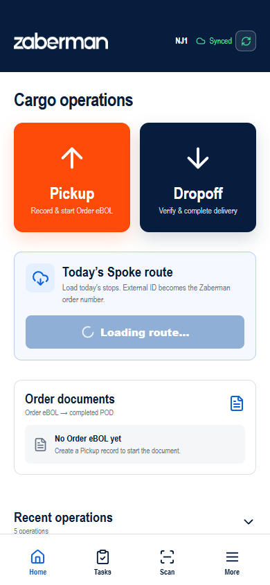
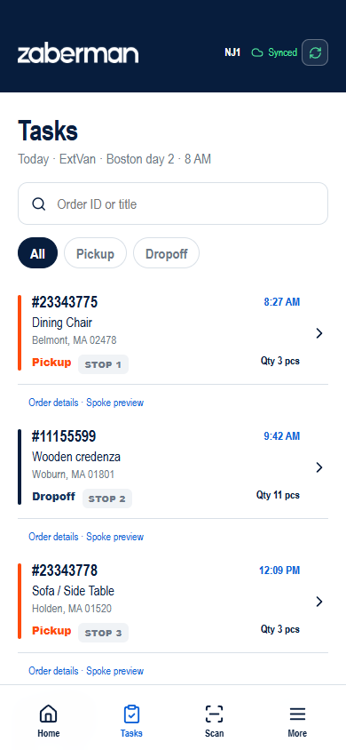
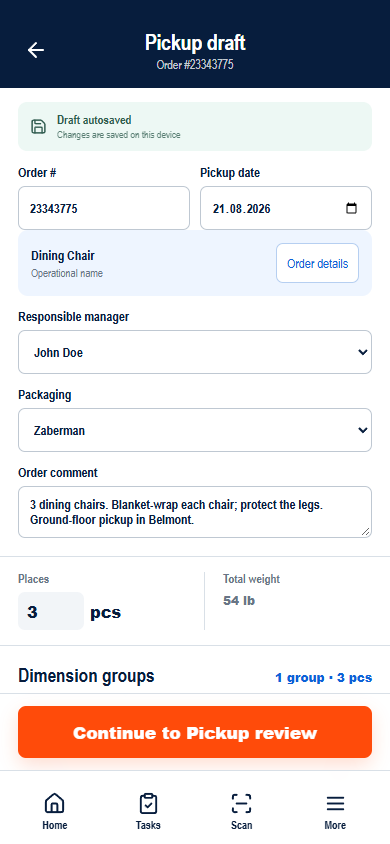
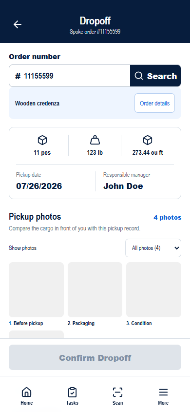
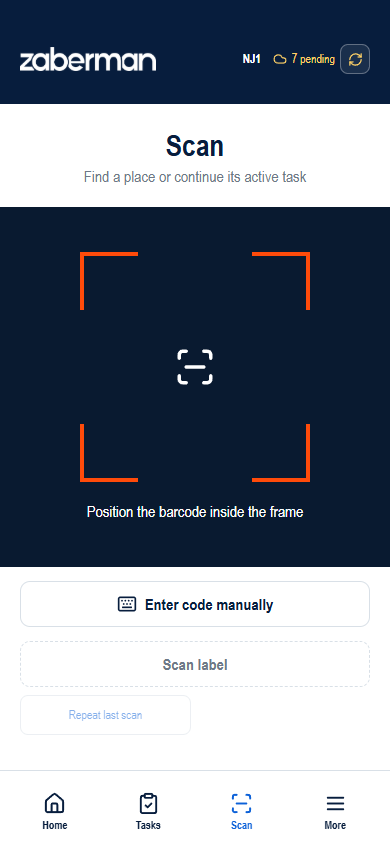
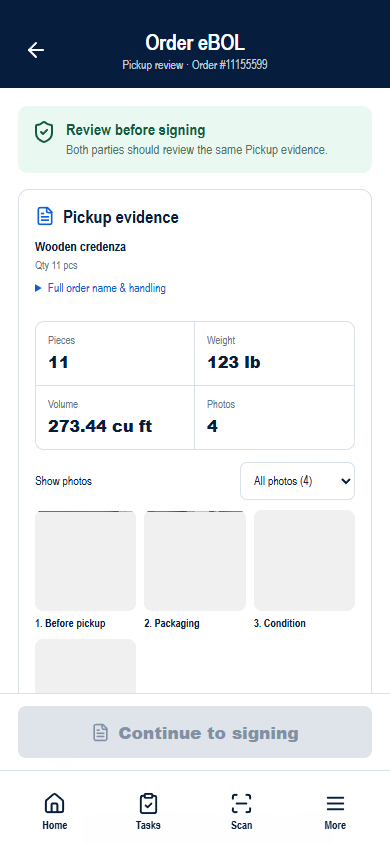
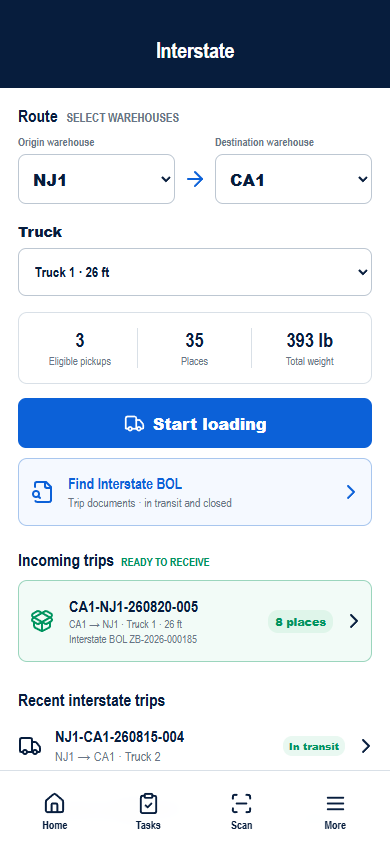

# User guide

HOV-001 update, 2026-11-03: before final Pickup, Supplemental or Delivery confirmation, obtain the driver signature → **Scan label** → **Check QR & location**. Confirm normally when both checks pass. For a warning, the primary action is **Return to check**; **Continue & confirm** requires a reason. An unknown code requires another scan. **Document versions → QR & location history** shows results, driver, time, distance/accuracy and the reason. Scanning never switches the active order. Settings and managed scenarios are in More → Administration; the 100 m radius is provisional.

This guide describes the **active** Mobile App interface. Buttons can change local prototype data; route loading, device actions, signatures, document sharing and sync are simulations. Use the on-screen order number and PlaceID when following an operation. Start with [Quick Start](quick-start.md) if you need the shortest route.

## Getting started and navigation

The first screen is **Cargo operations**. The compact **Manual operations** row contains **Pickup** and **Delivery** for opening an operation directly, even without a loaded route. For additional places on a signed Pickup, use **Recent operations → Add places** or resume **Supplemental Pickup** from **Pickup drafts**; the original signed version remains locked. The **Pre-trip inspection** card controls access to **Load today’s route**: the route remains locked until the inspection passes. A loaded route displays simulated Spoke stops with Order number, sequence, scheduled time, operation, quantity and address. Search the loaded stops by External ID. Order documents, saved Pickup drafts and Recent operations appear below when there are corresponding local records.

The bottom navigation contains:

| Section | Use it for |
| --- | --- |
| **Home** | Open Pickup/Delivery, load today's stops, resume a draft or open an Order eBOL. |
| **Tasks** | Find a loaded stop by Order ID or title; filter All, Pickup, Delivery; open its operation or Order details. |
| **Scan** | Look up a PlaceID or Order ID and open the matching cargo record. This tab does not record a loading or delivery event. |
| **More** | Help & Instructions, Sync now, Cargo places, Interstate operations and Administration. Administration controls role, branch, network, operation outcomes, device availability and local scenario data for demonstrations. |

### Active screen map

All paths below are hash routes under the deployed site. A listed route is interactive in the wireframe; the backend and external actions remain simulated.

| Entry | Screen and route | Next useful action |
| --- | --- | --- |
| Home | Cargo operations — `#/` | Pickup, Delivery, load route, Order documents |
| Home | Pre-trip inspection — `#/pre-trip-inspection` | Complete four checks, 13 photos and driver attestation |
| Home, after Pre-trip | Post-trip inspection — `#/post-trip-inspection` | Record vehicle condition after use; view completed/archived inspections |
| Home / bottom nav | Tasks — `#/tasks` | Open Pickup/Delivery stop; Order details |
| Bottom nav | Scan — `#/scan` | Open place or order places |
| Home / Inbox / Tasks / Pickup draft / Order details | Messages & Calls — `#/communications`, `#/communications?tab=calls`, `#/orders/{number}/communications` | Review messages and call history; send SMS or call the selected Order contact |
| Bottom nav | More — `#/more` | Help & Instructions, Interstate, Cargo places, Sync now, Administration |
| Home / Tasks | Pickup draft — `#/pickup?order={number}` | Pickup review or place labels |
| Tasks / Pickup | Order details — `#/orders/{number}/details` | Return to operation |
| Pickup | Place labels — `#/orders/{number}/labels` | Print/preview, Scan, Pickup review |
| Pickup | Pickup review — `#/orders/{number}/ebol/pickup` | Pickup signing |
| Pickup review | Pickup signing — `#/orders/{number}/ebol/pickup/sign` | Locked Pickup review |
| Home / Tasks | Delivery — `#/dropoff?order={number}` | Delivery review or Pickup review |
| Delivery | Delivery review — `#/orders/{number}/ebol/delivery` | Delivery signing |
| Delivery review | Delivery signing — `#/orders/{number}/ebol/delivery/sign` | Completed Order eBOL / POD |
| Completed Order eBOL | POD — `#/orders/{number}/ebol/pod` | View document versions and actions |
| More | Help & Instructions — `/Mobile_app/help/ru/` | Open the mobile-friendly Russian guide; switch to English from the documentation menu |
| More | Cargo places — `#/places`; place — `#/places/{PlaceID}` | Inspect status, location, history |
| More | Interstate — `#/interstate` | Loading, incoming trip, BOL archive |
| Interstate | Loading — `#/interstate/loading` | Review — `#/interstate/review`; Trip — `#/interstate/trip` |
| Interstate | Unloading — `#/interstate/unloading/{TripID}` | Review and confirm unloading |
| Interstate | BOL archive — `#/interstate/bols`; document — `#/interstate/bol/{BOL number}` | View, Save as PDF, Print |

The code contains older Home, Pickup, Delivery and Same Day components that are not in the active route map; do not use their screens as instructions. [Route source](../../wireframe/src/App.tsx).

## Pre-trip inspection

**Purpose:** confirm that the assigned vehicle is safe before loading Today's route.

1. On Home, find the **Pre-trip inspection** card for **Van 08 · Extended Van**. Select **Start** or **Continue**.
2. Inspect four groups: Lights & reflectors, Windows, mirrors & wipers, Leaks under vehicle, Emergency equipment. Select **Pass** or **Issue** for each.
3. Select **Continue to photos**. Take one photo for each card: Front, Rear, Driver side, Passenger side, Dashboard, Tires & wheels, 2x Dollies, Hand truck, Scales, 2x Utility knifes/Measuring tape, Lamp, DeWalt case, Milwaukee open bag.
4. Select **Review inspection**. If every check passes, select **I confirm this vehicle is safe to operate**, then **Complete inspection**.
5. The result shows **Ready for route**. Return Home; the card shows **Vehicle cleared** and **Load today’s route** is enabled.

Any **Issue** produces **Route locked** and disables completion. Select **Review issues** and change the result only after the physical condition has been resolved. If Camera unavailable appears, camera access must be restored before the inspection can finish. Completed inspections are read-only. The wireframe stores a local vehicle cycle and history; it does not create a maintenance task or supervisor override.

## Post-trip inspection

1. After completing Pre-trip, return Home and select **Start** in **Post-trip inspection**. A loaded route is not required.
2. Select **Pass** or **Issue** for the same four checks as Pre-trip. Describe each Issue before continuing.
3. Select **Continue to photos**. Capture the same 13 required photos as Pre-trip.
4. Select **Review inspection** and confirm **I confirm this inspection record is accurate**. If stops have no completed handoff, acknowledge that they remain unfinished and must be reported to dispatch.
5. Select **Complete Post-trip**. An Issue does not prevent submission: the result shows **Completed — issues reported** and **Vehicle needs attention**. Report defects to dispatch; the inspection does not send a message or close orders.
6. **Back to Home** → **Start next vehicle cycle** opens a fresh Pre-trip. The previous pair remains in **Previous vehicle inspections**. A warning reminds you of defects in the previous Post-trip; beginning a new cycle does not confirm repairs.

Drafts and read-only results survive refresh. If saving fails, check device storage and retry; do not leave until the action succeeds. Photos are local capture markers, not real images. Inspection timestamps do not calculate working hours.

## Tasks and Order details

In **Order details**, check **Product List** for the items and their quantities. **Places** shows the number of recorded cargo places. **Requirements** shows instructions, COI and the broker comment when available. **Copy summary** includes the transport instructions.

Open a thumbnail in **Reference photos** to inspect the image. This gallery contains photos supplied with the order. Photos captured by the crew are in the Pickup and Delivery flows. To see the update, open order **#11098765** and select **Refresh order**. A second photo appears and remains available when the order is reopened. The prototype uses local order snapshots for this scenario.

1. After **Vehicle cleared**, select **Load today’s route** on Home if Today's stops are not shown. This loads a local fixture; it does not connect to Spoke.
2. Open **Tasks**. Search by Order ID or title, or choose All, Pickup or Delivery.
3. Select the task card to open the correct operation. The compact **Order details** link opens its stop summary and team contacts; the message icon opens the customer conversation, with a badge for unread messages. **Spoke preview** remains available inside Order details.
4. Use the screen's own primary action to save or confirm. Opening a task alone does not mark it complete.

The current Tasks list does not show a universal task-status lifecycle. It shows scheduled stops; Pickup, Delivery and Order eBOL have separate local states. Avoid interpreting a task row as server assignment or completion.

On Home and Tasks, each stop is enclosed in a compact white card with a thin border, rounded corners and a small gap between cards. The Order number and name form one emphasized heading: **#23343775 · Dining Chair**. Below it are the purple **Pickup** or green **Delivery** label, the stop number and quantity, the scheduled time, and the full address with map/copy icons. Long names wrap without truncation. There is no internal divider, shadow or extra action panel.

For drivers, **Order details** is a reading screen, not an edit form. Handling requirements, when present, stay expanded before the contacts; orders without requirements do not show a Special Cargo: None card. Expand **Additional details** for External name and Source. **Spoke preview** and **Order change history** start collapsed. Dispatcher/Supervisor editors and their existing permissions are unchanged.

## Team contacts

Open **Order details** from Pickup/Delivery or Tasks and scroll to **Team contacts**. The card shows this order's Dispatcher, Broker and Manager, separately from the customer contact. Select **@nickname** to open Telegram; compose and send the message yourself. **Not assigned** means no contact is available for that role.

Check the number, name, quantity, operation, address, scheduled time and handling/order note. If several stops are available, choose **Order stop** first. Select **Copy summary**, then paste it into your message. If Clipboard is blocked, select and copy the displayed **Order summary** manually. Missing data is shown explicitly; OTP/signatures are not copied.

Names and Telegram handles are unverified sample data: agree recipients before external demonstrations. Opening Telegram depends on the device/browser; no messaging integration is connected.

## Navigate to a stop

On Home's **Today's stops**, Tasks, Pickup/Delivery or Order details, check the full address and select **Navigate**. It opens Google Maps in a new tab or supported external app; depending on the device/location, you may see directions preview rather than immediate navigation. The original screen remains open. No arrival, stop completion or order status is recorded by this action.

On Home/Tasks and Order details, the arrow icon beside the address opens Maps; the overlapping-sheets icon copies the complete address and changes to a checkmark on success. On Pickup/Delivery, **Copy address** changes to **Copied** without moving the content. **Copy summary** similarly changes to **Summary copied**. If Clipboard is unavailable, select the displayed text manually. For several possible stops, use **Select stop in Order details** and choose **Order stop** first. An unavailable address has no active Navigate link; select **Contact team** to clarify the destination.

On Home, departure actions remain blocked before Pre-trip clearance or after Post-trip completion. When navigating from Pickup/Delivery, a save error blocks opening Maps: keep the form open, check device storage and retry. Ordinary driving directions do not guarantee commercial-vehicle height/weight/access compliance. Set up navigation while safely stopped, not while driving.

## Pickup

**Purpose:** capture the places and evidence received at Pickup, then confirm the Pickup handoff in Order eBOL.

**When to use:** open a Pickup stop from Home/Tasks or choose Pickup on Home, then select the correct order.

1. Check the **Order #**, operational name and **Order details**. If you need to contact the customer without leaving the order, select **SMS** in the order card; an unread badge shows new replies. If the name or handling details are incomplete, open Order details and fill fields available to your current role.
2. Check **Items** and **Pickup Notes** in the order card. Add an **Order comment** if needed. For a stop opened from the route, the order number, planned date and address are read-only. When opening Pickup manually, enter the order number and Pickup date.
3. For each **dimension group**, enter **Qty**, L/W/H in inches and weight per place in pounds. Groups represent places with the same attributes; each place retains its own PlaceID. Add or remove groups as needed. If a measurement cannot be supplied, mark it or leave it unknown and record **Reason for unmeasured values**. The screen displays known totals separately from incomplete places.
4. Inspect **Cargo photos**. Add with **Take photo** or **Choose from gallery**, select a category and review the thumbnails. An individual photo can be previewed and removed while editing. In this wireframe these actions use local sample assets/metadata.
5. Wait for the draft status to say saved. The form autosaves locally and can be resumed from Home. Correct any **Order data incomplete** or measurement warnings. **Continue to Pickup review** enables only when the Order number, at least one place, at least one photo and required details are present and the draft saved.
6. Select **Continue to Pickup review**. The confirmation page says **Pickup draft ready**. You may open **Place labels** first: choose all, selected or one label, check the preview and select **Print**. If the printer is unavailable, continue to review and use the PlaceID check path.
7. Open **Pickup review**. Check pieces, weight, volume, photos, condition and any exception. Comments are entered during confirmation, not on Review. If evidence changed after review, return and review it again.
8. Choose **Sign on device** or **SMS code** for the Pickup contact. For SMS code, select **Send verification code**, enter the six-digit code supplied by the contact and select **Verify recipient**. In the prototype every six-digit code succeeds except `111111`; three invalid attempts lock verification. Supply contact or driver names as requested. Documented damage/exception requires its note.
9. Select **Continue to signing** for an on-device signature or **Continue to driver signature** after OTP verification. For on-device signing, have the contact sign, optionally request an email copy of this document version, and select **Accept contact signature**. For SMS code, the verified OTP replaces only the contact signature. Have the Zaberman driver sign and select **Confirm & lock Pickup snapshot**.

**Result:** the Pickup snapshot is locked and read-only. An additional place must be entered as **Supplemental Pickup** with a new document version and fresh confirmations. A saved Pickup draft or a “Pickup draft ready” message alone is not the final handoff confirmation. [Pickup source](../../wireframe/src/screens/PickupCaptureScreen.tsx), [review](../../wireframe/src/screens/PickupEbolScreen.tsx), [signing](../../wireframe/src/screens/PickupSignatureScreen.tsx).

## Delivery

**Purpose:** compare delivered cargo against Pickup evidence, record condition and confirm the Delivery handoff.

1. Open the Delivery stop from Home/Tasks. The card displays the order number, planned date and address from the route. For a manual lookup, choose **Delivery**, enter the order number and select **Search**. “Order not found” means the current local state has no recorded Pickup for that number.
2. Check the name, **Items**, **Delivery Notes** and order comment. Review the actual places, weight, volume, Pickup date and Pickup photos separately. Complete and sign any unfinished Supplemental Pickup before confirming Delivery.
3. Add **Delivery photos** and compare the cargo against Pickup evidence.
4. Select **Cargo matches pickup photos** only when the comparison is true. Select **No visible damage**, or choose **Report damage instead** and enter **Damage details**. Documented damage does not block the handoff.
5. Select **Continue to Delivery review**. This saves Delivery evidence; the handoff is not completed yet. If the Pickup snapshot is not locked, use the offered **Open Pickup review** action first.
6. Open **Delivery review**. Check evidence and exceptions, enter the driver name and choose one contact confirmation method:
   - **Sign on device** — enter the contact name and obtain the contact signature;
   - **SMS code** — select **Send verification code**, ask the recipient for the code sent to the registered masked number, then select **Verify recipient**. In the prototype every six-digit code succeeds except `111111`; three invalid attempts lock verification;
7. For SMS code, the signing action remains disabled until **Recipient verified** appears. For Offline, expired-code or delivery-error states, use the offered retry. If verification is locked, contact dispatch and do not choose a bypass method without approval.
8. Select **Continue to signing** or **Continue to driver signature**. Obtain the required signatures and select **Complete Order eBOL**.
9. Open **View POD**. With SMS code, POD records OTP verification, the recipient name and only the last four phone digits; it does not store the code.

**Result:** Step 5 saves Delivery evidence. The Order eBOL is completed at step 8. Its POD is a view of that completed document, not a third document. [Delivery source](../../wireframe/src/screens/DropoffVerifyScreen.tsx), [Delivery review](../../wireframe/src/screens/DeliveryEbolScreen.tsx).

## Comments during signing

These rules apply to Pickup, Supplemental Pickup and Delivery:

- The contact enters an optional **Your comment** on the contact signing screen, before signing. The driver enters their own **Your comment** on the driver signing screen; the contact's comment is read-only there.
- Changing your comment clears your signature: sign again. **Edit contact comment · sign again** returns to the contact step and requires both signatures again.
- With **SMS code**, enter any words relayed by the contact in **Contact comment (reported)** before verifying the code. After verification the field is locked. **Edit contact comment · verify again**, or changing an exception, requires a fresh OTP check. The driver adds their own comment before signing.
- Both fields are optional, up to 1,000 characters each. Drafts save locally; after a refresh the text remains, but on-device signatures must be collected again. If saving fails, keep the screen open and retry before continuing.
- Comments belong only to this document version and become read-only after completion. Damage or disagreement must still be recorded separately as an exception.

## Same Day

The approved process model treats Pickup and Delivery as separate operations linked to one RouteRun. The active app can show both types of stop on Today's route, but has no routed Same Day progress screen or verified automatic pairing of the two. Complete each stop through its normal Pickup or Delivery path. Do not assume that finishing Pickup automatically completes or creates a Delivery task. [Same Day article](../../knowledge-base/mobile-app/same-day.md).

## Customer messages and calls

Open **Inbox** from Home or the bottom navigation, then choose **Messages** or **Calls** under **Messages & Calls**. You can also open **Message customer** from a task or Order details, or **SMS** from the order card in Pickup draft. Every message conversation is tied to one Order and customer contact.

1. In **Messages**, search by Order, customer or message text. Use **All** or **Unread** to narrow the inbox.
2. Open the required conversation and verify the customer, Order and operation in the header. The sender identity is the Zaberman corporate SMS number **17178361039**; the employee's personal phone number is not used or shown.
3. The first quick message is **We'll be there in 20 minutes**. Select it to fill the editor; adjust the minutes or text if needed, then select **Send**. Selecting a template does not send it. **On my way**, **Arrived**, **Running late** and **Please confirm access** remain available, or you can type a custom message.
4. Check the status: Sending, Sent, Queued until online or Not sent. Offline messages send automatically after the connection returns. For Not sent, use **Retry**.
5. Incoming replies appear as unread in Messages, the related task and the **SMS** button. Opening the conversation clears its unread count. Use **Open order** to return to the related operation.
6. To call the same customer, select **Call** in the conversation. Confirm the customer, Order and **Calling from** number, then select **Start call**. During a connected call you can toggle **Mute** or **Speaker** and select **End call**. Use **Call again** or **Back to messages** when it ends.

To return a call, open **Inbox → Calls**. Search by customer, phone or Order; use **Missed** for missed calls. Check the Order and **Route date**, shown separately from the call time. **Suggested order** is an inferred match; if several orders match, choose one before **Call back**. Review the contact and select **Start call**. If no matching customer thread exists, callback is unavailable.

Opening Calls clears the new missed indicator but keeps the missed entries. A callback adds a separate outgoing entry and does not mark the original missed call as resolved. Completed/cancelled entries and seen indicators are stored locally. Offline, you can read history but cannot start a call. The Inbox badge combines unread messages and new missed calls.

In the current wireframe, SMS and call states/history are local demonstrations; no telephony provider, audio connection, webhook, push notification or production communication history is connected. An active call is not guaranteed to survive a reload; choosing an Order for an incoming entry is temporary.

## Cargo, Scan and labels

A **dimension group** records quantity and shared dimensions/weight; the app preserves a distinct **PlaceID** for each physical place. **More → Cargo places** supports search by PlaceID, Order or location and opens a place record with label, status, location and short event history. Place labels are available after saving a Pickup. Reprint uses the same PlaceID in the wireframe.

To look up cargo, open **Scan**. Use **Scan label** if the simulated scanner is available, or **Enter code manually**, enter a PlaceID or Order ID and select **Find**. A found place can be opened; an Order ID opens all known places for that order. A repeated PlaceID in the same visit shows **Already scanned this visit**. An unknown code shows **Code not found** and creates nothing. The main Scan tab is lookup only; to load or receive cargo, use the input on the Interstate Loading or Unloading screen. The displayed label is Code 128; a QR-specific path is not demonstrated. [Scan source](../../wireframe/src/screens/ScanScreen.tsx).

## Photos

Pickup and Delivery forms each require at least one photo for their primary confirmation action in the active UI. The editor supports categories **Before pickup**, **After delivery**, **Packaging**, **Condition** and **Damage**, preview and removal during editing. Pickup and Delivery galleries stay separate in review/POD; Supplemental Pickup has its own photos. The current camera/gallery actions use bundled sample images and local metadata. The app does not establish a production policy for required angles or exact subject matter. [Photo editor](../../wireframe/src/PhotoEvidence.tsx).

## Order eBOL, POD and documents

**Order eBOL** belongs to one Order. Its Pickup and Delivery evidence are reviewed and then locked by the corresponding confirmations. **POD** is available after both are locked. The Home **Order documents** card opens the current stage. Document versions provide read-only original, Supplemental and Delivery records. Download, Print, Email and Share dialogs show a local result; they do not generate or deliver a production document. An optional Pickup contact email-copy request is tied to one signed version and is also simulated. Do not treat the displayed signatures as legally binding production signatures. [BOL decision log](../../BOL_DECISION_LOG.md), [wireframe README](../../wireframe/README.md).

## Interstate and Interstate BOL

1. Open **More → Interstate operations**. Choose distinct **Origin warehouse** and **Destination warehouse**, then a truck. Only eligible Pickup-recorded orders matching that direction appear for loading.
2. Select **Start loading**. Enter a PlaceID in **Scan or enter Place ID** and select **Load**, or expand an order and select individual place numbers or **Load all remaining**.
3. Select **Review N loaded places**. Check direction, truck, totals and manifest lines. Select **Create Trip & BOL**.
4. The Trip result shows TripID and Interstate BOL number. Open the BOL or return to Interstate. **Find Interstate BOL** opens a searchable archive with status filters; **Save as PDF** and **Print** call the browser print dialog.
5. To receive an incoming Trip, open it in **Incoming trips**. Enter or select the PlaceIDs received, then **Review unloading**. If places are missing, confirm the missing-place discrepancies. Select **Confirm unloading**.

The active prototype has a local Trip and receiving simulation. It does not demonstrate the entire physical movement, server close, or a linked final Delivery after unloading. The Order eBOL and Interstate BOL are different documents. [Interstate screens](../../wireframe/src/screens/InterstateScreen.tsx), [BOL screen](../../wireframe/src/screens/InterstateBolScreen.tsx).

## Completing operations and handling problems

| Message or state | What to do |
| --- | --- |
| Draft is saving / save error | Wait or keep the screen open, free browser storage if needed and retry. Do not sign from an unsaved draft. |
| Order data or measurements incomplete | Open Order details or add a reason for unknown measurement; return to the operation. |
| Order not found at Delivery | Check the number and that Pickup was recorded in this browser state. |
| Pending Supplemental Pickup | Resume and sign its new version before Delivery. |
| Review required | Return to the relevant review screen; direct signing links do not bypass review. |
| Pre-trip inspection required | Open the Home card and complete all four checks, 13 photos and the attestation before loading the route. |
| Route locked / Issue reported | Do not depart. Review the issue and follow the operating team's escalation process; the wireframe has no supervisor override. |
| Camera unavailable during Pre-trip | Restore camera availability; gallery upload cannot replace a required inspection photo. |
| Code not recognized | Recheck the six digits and retry. In the prototype `111111` is always invalid; after three failures contact dispatch. |
| Code expired / SMS could not be delivered | Send a new code or retry SMS. Check connectivity; the registered contact number cannot be edited on Pickup or Delivery review. |
| Verification locked | Do not bypass OTP with another method unless dispatch/supervisor approves it. |
| Camera/scanner/printer unavailable | Use the available manual PlaceID path or continue where the UI offers it. Print and scan hardware are not connected. |
| Scan code unknown or duplicate | Recheck the label/PlaceID. Lookup does not create cargo or record a movement. |
| Missing place at unloading | Review the manifest, continue receiving if appropriate, or explicitly confirm the discrepancy before closing. |
| Offline / sync retry / conflict | More shows local pending status. Retry when online; a conflict scenario offers **Keep local changes**. These are simulated outcomes, not proof of server delivery. |

For a problem without an on-screen resolution, stop before confirming the affected operation and use the team's operational escalation procedure. That procedure is not defined in the prototype and must be provided internally by the operating team.
